# BHIL Stagehand Theme Reel



**Twenty motion themes for the agents that build pages, reels and decks, and a self-contained reel that shows every one of them running at three intensity levels.**

A Stagehand theme is a costume layer: palette, type trio, motion grammar, transitions and video language. It never picks the format, never replaces the subject's own opening moment, and never overrides an accessibility or honesty gate. Themes evoke a genre and never copy a property, so this public edition uses codenames only.

[**Live reel**](https://polymathwizard.github.io/BHIL-Stagehand-Theme-Reel/reel/stagehand-theme-reel.html) · [**Docs**](https://polymathwizard.github.io/BHIL-Stagehand-Theme-Reel/) · [**Roster**](docs/themes/index.md) · [**Worked example**](docs/worked-example.md) · [**Figures**](docs/figures.md)

<!-- BEGIN:counts -->
**20 themes · 5 families · 3 intensity levels · 5 web slots · 10 figures · 7 agents · 11 prompts · 48 open-license font families**
<!-- END:counts -->

## What is inside

| Part | What you get |
| --- | --- |
| **The codex** | Twenty theme cards in five families, each with tokens, essence words, look, motion grammar, a five-slot web map, video grammar, data skin, Boardroom translation, homage guardrails, a collision note and a prompt seed. Plus the Homage Rule, the intensity dial, the safety table and the video kit. |
| **Tokens** | `tokens/stagehand-tokens.css` (all twenty, scoped by `data-tx`), one file per theme, and design-token JSON. |
| **The reel** | `reel/dist/stagehand-theme-reel.html`: one file, about 1 MB, twenty canvases, a sixteen-pass film pipeline, a Full, Tempered and Boardroom dial, and copy buttons for tokens and seeds. No network requests. |
| **The agent layer** | Seven Claude Code agents in `.claude/agents/` (an Opus director over Sonnet specialists, with a blind, read-only homage auditor) and eleven prompts, P00 to P10. |
| **Figures** | Ten animated SVG figures with embedded fonts and 1600 x 900 PNG twins, with a teaching sequence. |
| **Gates** | Stdlib validator, drift gate, regression tests and a canvas stub sweep of every scene at every level. |

## One theme, three volumes



Full is for creative and community work, Tempered for editorial and civic work, Boardroom for B2B intelligence. The theme keeps its identity; only the volume changes. Themes that cannot be calmed enough for a board deck say so, and the fit test will not pitch them for one.

## One dataset, twenty skins



Every theme charts the same sample numbers, and every data beat in the reel tells the same story: the chart builds, the insight lands, the data re-sorts, the ranks arrive. That makes twenty data skins comparable at a glance. [How the data beat works](docs/reel/data-beat.md).

## The roster

<!-- BEGIN:roster -->
| ID | Codename | Feel | Home | B2B fit |
| --- | --- | --- | --- | --- |
| TX-01 | [VECTOR GRID](docs/themes/tx-01-vector-grid.md) | Neon light-lines racing across an endless dark grid. | Creative | Has a Boardroom translation |
| TX-02 | [PHOSPHOR RAIN](docs/themes/tx-02-phosphor-rain.md) | Green code cascading until the hidden truth resolves. | Creative | Has a Boardroom translation |
| TX-03 | [GLASS HUD](docs/themes/tx-03-glass-hud.md) | Translucent data panels assembling around one datum. | B2B | Runs at Boardroom as is |
| TX-04 | [RAINLIGHT NOIR](docs/themes/tx-04-rainlight-noir.md) | Rain, haze and neon reflections in a city that watches. | Editorial | Has a Boardroom translation |
| TX-05 | [STUTTER BROADCAST](docs/themes/tx-05-stutter-broadcast.md) | A pirate-TV host stuttering through a glitching broadcast. | Creative | Boardroom is news-desk only |
| TX-06 | [OTHERSIDE ’83](docs/themes/tx-06-otherside-83.md) | 1983 night, a red-glow title, and a world flipped under the surface. | Creative | Tempered is the ceiling |
| TX-07 | [NIGHT DRIVE](docs/themes/tx-07-night-drive.md) | A pink-and-cyan night cruise toward a striped sunset. | Creative | Never pitched for B2B |
| TX-08 | [COLD STORAGE](docs/themes/tx-08-cold-storage.md) | Chunky CRT terminals humming in a cold industrial hull. | Editorial | Runs at Boardroom as is |
| TX-09 | [SPACE OPERA](docs/themes/tx-09-space-opera.md) | A perspective crawl, starfields and wipes at mythic scale. | Creative | Tempered is the ceiling |
| TX-10 | [SANDSCALE](docs/themes/tx-10-sandscale.md) | Monumental forms rising from haze; tiny figures, vast forces. | B2B | Runs at Boardroom as is |
| TX-11 | [WASTELAND CHROME](docs/themes/tx-11-wasteland-chrome.md) | Orange-and-teal pursuit at full throttle, center-framed. | Creative | Never pitched for B2B |
| TX-12 | [SLIT-SCAN COSMOS](docs/themes/tx-12-slit-scan-cosmos.md) | Light corridors, lensing rings, and silence as a beat. | Editorial | Runs at Boardroom as is |
| TX-13 | [CLOCKWORK REALM](docs/themes/tx-13-clockwork-realm.md) | A brass map where mechanisms rise to show who holds what. | B2B | Runs at Boardroom as is |
| TX-14 | [RED-LINE EXPEDITION](docs/themes/tx-14-red-line-expedition.md) | A red route inking across an aged map, stamp by stamp. | Editorial | Tempered is the ceiling |
| TX-15 | [PAINTED WIND](docs/themes/tx-15-painted-wind.md) | Hand-painted skies and wind moving through grass. | Editorial | Tempered is the ceiling |
| TX-16 | [PAPER CUT TITLES](docs/themes/tx-16-paper-cut-titles.md) | Flat cut-paper shapes snapping to a jazz beat. | B2B | Runs at Boardroom as is |
| TX-17 | [SILHOUETTE & SMOKE](docs/themes/tx-17-silhouette-smoke.md) | Gold light, silhouettes and ink-smoke morphs. | Creative | Tempered is the ceiling |
| TX-18 | [HALFTONE MULTIVERSE](docs/themes/tx-18-halftone-multiverse.md) | Comic panels, misregistered inks, one art style per world. | Creative | Never pitched for B2B |
| TX-19 | [SYMMETRY DIORAMA](docs/themes/tx-19-symmetry-diorama.md) | Centered pastel dollhouse sections and whip-pan chapter cards. | Editorial | Runs at Boardroom as is |
| TX-20 | [LIMINAL OFFICE](docs/themes/tx-20-liminal-office.md) | White corridors, teal carpet, and numbers that feel uneasy. | B2B | Runs at Boardroom as is |
<!-- END:roster -->

## Quick start

**Wear a theme on a page.**

```html
<link rel="stylesheet" href="tokens/stagehand-tokens.css">
<main data-tx="TX-16">
  <h1 style="font-family: var(--tx-display); color: var(--tx-ink)">Four moves, measured</h1>
</main>
```

**Pick a theme the way the agents do.** Write five essence words and your data shape first, then:

```bash
python3 scripts/fit_test.py --words "monitoring, precision, systems, warning, compliance" --shape score --register b2b --ledger TX-03
```

**Run the agent team.** Open the repo in Claude Code and start the `stagehand-director` with prompt P00. It runs the eight moves, delegates each stage, sends the build to a blind auditor and ends with one manifest line:

```text
theme: TX-08 COLD STORAGE · boardroom · fit 2/5 · homage-check PASS
```

## Evoke the genre, never the property



Themes borrow light, palette mood, type feel, camera language, edit rhythm and sound texture. They never ship names, logos, characters, invented terms, quotes, scores, stills or franchise typefaces. Inspirations live in BHIL's internal brief; this repository enforces their absence with a salted, hashed deny list, so the list itself never ships. [The Homage Rule](docs/codex/homage-rule.md) · [ADR-002](docs/adr/adr-002-public-edition.md).

## Gates

```bash
python3 scripts/validate.py          # canon, 11:1 contrast, homage deny list, dash gate, agent tool isolation, prompts, ADRs, figures, reel
python3 scripts/verify_drift.py      # every generated file matches canon, byte for byte
python3 -m unittest discover -s tests
node tests/reel_stub_sweep.js reel/dist/stagehand-theme-reel.html
mkdocs build --strict
```

Generators and gates are stdlib Python. The reel and figure builders are the only non-stdlib tools; their outputs are committed and freshness-checked by hash ([ADR-004](docs/adr/adr-004-self-contained-reel.md), [ADR-006](docs/adr/adr-006-figure-kit.md)).

## Figures

<!-- BEGIN:figures -->
| ID | Figure | Use it in |
| --- | --- | --- |
| STC-01 | [Twenty themes. One stage.](docs/assets/figures/png/stc-01-masthead.png) | README hero, docs home |
| STC-02 | [Five families. Each knows its room.](docs/assets/figures/png/stc-02-families-and-fit.png) | Roster, selection matrix |
| STC-03 | [Every card carries the same eleven fields.](docs/assets/figures/png/stc-03-card-anatomy.png) | Card anatomy, token schema |
| STC-04 | [Five slots on the page. Twenty loops on the reel.](docs/assets/figures/png/stc-04-slots-and-beats.png) | Web slots, reel structure |
| STC-05 | [One theme. Three volumes.](docs/assets/figures/png/stc-05-intensity-dial.png) | Intensity dial, Boardroom translations |
| STC-06 | [Sixteen passes make one frame.](docs/assets/figures/png/stc-06-film-pipeline.png) | Reel engine, contributing guide |
| STC-07 | [Build. Insight. Re-sort. Rank.](docs/assets/figures/png/stc-07-data-story.png) | Data skin, chart guidelines |
| STC-08 | [One dataset. Twenty skins.](docs/assets/figures/png/stc-08-twenty-skins.png) | Data skins gallery |
| STC-09 | [Evoke the genre. Never the property.](docs/assets/figures/png/stc-09-homage-rule.png) | Homage Rule, contributor policy |
| STC-10 | [From brief to manifest in eight moves.](docs/assets/figures/png/stc-10-brief-to-manifest.png) | Agent workflow, build manifest |
<!-- END:figures -->

## Layout

```text
canon/            source of truth (themes, families, dial, slots, homage, workflow, pipeline, safety, video, bench, fonts, claims, agents, prompts, figures, examples)
reel/src/         reel sources; data.js is generated
reel/dist/        the built reel and its input hashes
tokens/           generated CSS and JSON tokens
docs/             MkDocs site (themes, codex, reference and reel tables are generated)
docs/assets/figures/  STC-01 to STC-10, svg and png
prompts/          P00 to P10
.claude/agents/   seven agents
scripts/          generators, gates, fit test, homage tool, reel and figure builders
tests/            regression tests and the canvas stub sweep
```

## License

Code and schemas: [MIT](LICENSE). Content (codex text, cards, prompts, figures): [CC BY 4.0](LICENSE-CONTENT.md). Fonts keep their own SIL OFL 1.1 or Apache 2.0 licenses. Nothing here is endorsed by or affiliated with any rights holder of any work a theme evokes.

**Barry Hurd Intelligence Lab** · [barryhurd.com](https://barryhurd.com) · https://github.com/PolymathWizard/BHIL-Stagehand-Theme-Reel

*Human-Directed. AI-Enabled. Commercially Tested.*
