# Figures

<!-- Generated from canon by scripts/build_derived.py. Do not edit by hand. -->

Ten figures for READMEs, docs and teaching. SVG animates with CSS only and stops under reduced motion; PNG is the designed static frame. Files live in `docs/assets/figures/` (`svg/` and `png/`).

## Teaching sequence

Ten short sessions, one figure each.

### STC-01 · Twenty themes. One stage.

**Teaches:** What a motion theme is, and why there are twenty. **Exercise:** Pick three tiles and say which kind of story each would suit. **Use it in:** README hero, docs home. PNG: [`stc-01-masthead.png`](assets/figures/png/stc-01-masthead.png)

### STC-02 · Five families. Each knows its room.

**Teaches:** Families, home register and B2B fit. **Exercise:** Sort five of your recent projects by register, then shortlist themes for each. **Use it in:** Roster, selection matrix. PNG: [`stc-02-families-and-fit.png`](assets/figures/png/stc-02-families-and-fit.png)

### STC-03 · Every card carries the same eleven fields.

**Teaches:** The eleven card fields and the stage that reads each one. **Exercise:** Write the tokens block for a new theme and check that ink on ground reaches 11:1. **Use it in:** Card anatomy, token schema. PNG: [`stc-03-card-anatomy.png`](assets/figures/png/stc-03-card-anatomy.png)

### STC-04 · Five slots on the page. Twenty loops on the reel.

**Teaches:** S1 to S5 on the page, and how each reel beat demonstrates one slot. **Exercise:** Map the five slots onto a page you already ship. **Use it in:** Web slots, reel structure. PNG: [`stc-04-slots-and-beats.png`](assets/figures/png/stc-04-slots-and-beats.png)

### STC-05 · One theme. Three volumes.

**Teaches:** Full, Tempered and Boardroom, and what each one keeps or removes. **Exercise:** Take one theme and write its Tempered and Boardroom versions in a line each. **Use it in:** Intensity dial, Boardroom translations. PNG: [`stc-05-intensity-dial.png`](assets/figures/png/stc-05-intensity-dial.png)

### STC-06 · Sixteen passes make one frame.

**Teaches:** The render pipeline, the scene API and the quality governor. **Exercise:** Add a pass on paper: where does it go, and what does each level do to it? **Use it in:** Reel engine, contributing guide. PNG: [`stc-06-film-pipeline.png`](assets/figures/png/stc-06-film-pipeline.png)

### STC-07 · Build. Insight. Re-sort. Rank.

**Teaches:** The four-part data story every reel data beat tells. **Exercise:** Storyboard the same four beats for a line chart instead of bars. **Use it in:** Data skin, chart guidelines. PNG: [`stc-07-data-story.png`](assets/figures/png/stc-07-data-story.png)

### STC-08 · One dataset. Twenty skins.

**Teaches:** One dataset in twenty palettes and display faces. **Exercise:** Which skins still read in a grayscale print? Which fail, and why? **Use it in:** Data skins gallery. PNG: [`stc-08-twenty-skins.png`](assets/figures/png/stc-08-twenty-skins.png)

### STC-09 · Evoke the genre. Never the property.

**Teaches:** Borrow the grammar, never the property; naming and the swap test. **Exercise:** Run the swap test on a theme and log what you would cut. **Use it in:** Homage Rule, contributor policy. PNG: [`stc-09-homage-rule.png`](assets/figures/png/stc-09-homage-rule.png)

### STC-10 · From brief to manifest in eight moves.

**Teaches:** How an agent picks, tunes, checks and records a theme. **Exercise:** Walk a real brief through the eight moves and write the manifest line. **Use it in:** Agent workflow, build manifest. PNG: [`stc-10-brief-to-manifest.png`](assets/figures/png/stc-10-brief-to-manifest.png)
