# Stagehand Theme Codex

**Twenty motion themes for the agents that build pages, reels and decks, and one self-contained reel that shows every theme running at three intensity levels.**

A Stagehand theme is a costume layer. It lends a page its palette, type trio, motion grammar, transitions and video language. It never decides the format, never replaces the subject's own signature moment, and never overrides an accessibility or honesty gate. The codex exists so that an agent asked for "something with the feel of an 80s broadcast" or "make the brief feel like a heist title sequence" has a vetted, open-license, accessible answer instead of an improvised imitation.

[Open the live reel](https://polymathwizard.github.io/BHIL-Stagehand-Theme-Reel/reel/stagehand-theme-reel.html){ .md-button .md-button--primary } [Browse the roster](themes/index.md){ .md-button }

## What is in the box

| Part | What it gives you | Start here |
| --- | --- | --- |
| The codex | Twenty theme cards in five families, the Homage Rule, the intensity dial, token schema, web slot map, video kit and safety table | [How agents use the codex](codex/how-agents-use.md) |
| Tokens | Paste-ready CSS custom properties and design-token JSON for every theme | [Token files](reference/tokens.md) |
| The reel | One HTML file, about 1 MB, twenty canvases, a film pipeline and a three-position dial. No network requests. | [The reel](reel/index.md) |
| The agent layer | Seven Claude Code agents and an eleven-prompt pack that take a brief from essence to manifest | [Agents and prompts](agents.md) |
| Figures | Ten animated SVG figures with PNG twins, built for READMEs and teaching | [Figures](figures.md) |
| Gates | Stdlib validator, drift gate and regression tests, plus a canvas stub sweep of every scene | [Getting started](getting-started.md#gates) |

## The ideas that hold it together

**Evoke the genre, never the property.** Themes borrow light, palette mood, type feel, camera language, edit rhythm and sound texture. They borrow nothing a studio owns: no names, logos, characters, quotes, scores, stills or franchise typefaces. This repository is the public edition, so the inspirations themselves never appear here, and a hashed deny list enforces that in CI. See [the Homage Rule](codex/homage-rule.md) and [ADR-002](adr/adr-002-public-edition.md).

**One theme, three volumes.** Full is for creative and community work. Tempered is for editorial and civic work. Boardroom is for B2B intelligence and is the BHIL default. The theme keeps its identity at every level; only the volume changes. See [the intensity dial](codex/intensity-dial.md).

**Five slots, one grammar.** Every themed page fills the same five slots: hero signature, section transitions, ambient layer, data skin, and interaction. Each card says how its theme fills each one, with a build tier, so an agent knows the cost before it commits. See [web slots](codex/web-slots.md).

**One dataset, twenty skins.** The reel charts the same sample numbers in every theme, and every data beat tells the same four-part story: build, insight, re-sort, rank. That makes the skins comparable at a glance. See [the data beat](reel/data-beat.md).

**Canon is the only source.** Every theme page, token file, reference table and the reel's own data are generated from `canon/*.json`. Hand edits to generated files fail the drift gate. See [ADR-001](adr/adr-001-canonical-source.md).

## Who it is for

- **Site, reel and deck agents** that need a theme they can apply mechanically: tokens, slot fills, Boardroom translation, guardrails, prompt seed.
- **Creative directors and editors** who want a shared vocabulary for "how loud" a piece should be, and a ledger rule that keeps themes from repeating.
- **Teachers and students** of motion design and data storytelling: the figures and the reel make the grammar visible, and the [figure page](figures.md) includes a ten-session teaching sequence.

## How this edition was made

The codex (STC v1.0) was written on 2026-11-06 as an internal BHIL brief. The reel went through five refinement passes: a one-page reel, detailed beats, a post-processing layer, a film pipeline, and the data-story layer. This repository packages the public edition of both, with the gates BHIL uses on every framework repository. The full history is in the [changelog](changelog.md).

*Barry Hurd Intelligence Lab · Human-Directed. AI-Enabled. Commercially Tested.*
