# The data beat

<!-- Generated from canon by scripts/build_derived.py. Do not edit by hand. -->

Every theme has one S4 beat, and every S4 beat tells the same story in 9.5 s: the chart builds, the insight lands, the data re-sorts, the ranks arrive.

| Phase | Starts (s) | Ends (s) | What happens |
| --- | --- | --- | --- |
| Build | 0.3 | 2 | Bars rise with a slight overshoot, 0.12 s apart, and the values count up. |
| Insight | 2.8 | 5.5 | The average line draws, the leader stays lit, the rest dim to half, and a callout names the gap. |
| Re-sort | 5.6 | 7.2 | Bars glide into rank order: a 1.3 s ease in and out, 0.09 s apart. |
| Rank | 7 | 9 | Rank labels arrive, the chart holds, then it exits on the beat. |

## The sample dataset

Every number in the reel and the figures is a placeholder from this one dataset, labeled SAMPLE on screen.

| Series | Values |
| --- | --- |
| Bars (N1, N2, N3, N4, N5, N6) | 62, 84, 48, 91, 70, 56 |
| Line, 12 weeks | 0.32, 0.38, 0.35, 0.47, 0.52, 0.49, 0.61, 0.66, 0.63, 0.74, 0.79, 0.86 |
| Share | 34%, 22%, 31%, 13% |
| KPI | 87.4 |

Average of the bars: 68.5. Leader: N4 at 91.

## Data skins, theme by theme

| Theme | Data skin | S4 fill |
| --- | --- | --- |
| [TX-01 VECTOR GRID](../themes/tx-01-vector-grid.md) | Hairline luminous strokes, no fills, mono values. The rival series is always the orange. | bars as glowing light-walls (scaleY only), lines as trails with a fading wake. |
| [TX-02 PHOSPHOR RAIN](../themes/tx-02-phosphor-rain.md) | 5-step monochrome green ramp, mono numerals, glyph-noise texture in empty chart space at 5%. | numbers decode from glyph noise to the true value, which sits in the DOM. |
| [TX-03 GLASS HUD](../themes/tx-03-glass-hud.md) | Thin rings, bracketed labels, tabular mono numerals, amber for any threshold crossing. | radial gauges, ring meters, sparklines with tick ladders. |
| [TX-04 RAINLIGHT NOIR](../themes/tx-04-rainlight-noir.md) | Bars as vertical light columns, orange-vs-teal for two series, tall condensed caps for labels. | tall translucent "billboard" stat panels with a scanning light. |
| [TX-05 STUTTER BROADCAST](../themes/tx-05-stutter-broadcast.md) | Flat primary bars on black, VT323 tickers, key numbers delivered as "breaking" chyrons. | charts "change channel" between states (crossfade + 150 ms noise). |
| [TX-06 OTHERSIDE ’83](../themes/tx-06-otherside-83.md) | Two-worlds comparisons, surface versus underneath. "Hidden" series are dashed until the flip. | charts as 80s graph-paper plots and photocopied handouts; the flipped chapter shows the same chart with the hidden variable revealed. |
| [TX-07 NIGHT DRIVE](../themes/tx-07-night-drive.md) | Pink-to-cyan gradient bars, outlined neon numerals. | equalizer bars and gradient chrome numerals. |
| [TX-08 COLD STORAGE](../themes/tx-08-cold-storage.md) | Segmented bars, monochrome green with amber thresholds; red only for a breach. | segmented bar meters, 7-segment counters, blinking threshold lamps. |
| [TX-09 SPACE OPERA](../themes/tx-09-space-opera.md) | Gold on black, Roman-numeral episodes, factions as color pairs. | fleet-style unit charts (small glyph units), star-map networks, episode timelines. |
| [TX-10 SANDSCALE](../themes/tx-10-sandscale.md) | Slabs, contours and scale figures. Every comparison is drawn at true proportion. | bars as textured stone slabs, contour terrain charts for distributions, tiny figures for per-capita comparisons. |
| [TX-11 WASTELAND CHROME](../themes/tx-11-wasteland-chrome.md) | Gauges and needles, stencil labels, orange versus teal for rivals. | gauge needles, warning-stencil labels, heat-scorch maps. |
| [TX-12 SLIT-SCAN COSMOS](../themes/tx-12-slit-scan-cosmos.md) | Hairline strokes, log scales, ring diagrams. | log-scale timelines, orbital diagrams, dual "time-dilation" clocks. |
| [TX-13 CLOCKWORK REALM](../themes/tx-13-clockwork-realm.md) | Tile maps, brass-ruled tables, engraved numerals. | territories as tiles that flip to reveal share, plus brass-ruled tables. Gear size is decoration, never data. |
| [TX-14 RED-LINE EXPEDITION](../themes/tx-14-red-line-expedition.md) | Timelines drawn as routes, stamps as markers, ledger-style tables. | routes annotated with distance and time, dated stamps as data markers, ledger tables. |
| [TX-15 PAINTED WIND](../themes/tx-15-painted-wind.md) | Hand-painted feel, rounded labels, natural metaphors used honestly (a growing plant only where the number actually grows). | watercolor charts: Rough.js hachure with soft fills on paper texture. |
| [TX-16 PAPER CUT TITLES](../themes/tx-16-paper-cut-titles.md) | Flat fills, one accent per chart, labels set in condensed caps. | bars as cut strips, pies as paper wedges, arrows as cut shards. |
| [TX-17 SILHOUETTE & SMOKE](../themes/tx-17-silhouette-smoke.md) | Hairline gold, generous whitespace, Didone numerals. | thin gold line charts on black with Didone numerals. |
| [TX-18 HALFTONE MULTIVERSE](../themes/tx-18-halftone-multiverse.md) | One style per segment, the theme's tool for personas and multiple perspectives. | flat-ink charts with halftone shading and caption-box annotations, each segment drawn in its own visual dialect. |
| [TX-19 SYMMETRY DIORAMA](../themes/tx-19-symmetry-diorama.md) | Centered, labeled, inventory-like. Pictograms over bars. | pictogram rows, specimen-label charts, inventory tables. |
| [TX-20 LIMINAL OFFICE](../themes/tx-20-liminal-office.md) | Grids of numerals, bins, completion percentages, sterile tables. | a sorting interaction on a teal-on-black terminal grid: the reader drags numbers into bins, then sees the real distribution (predict-then-reveal). |
