# The reel

The reel is the codex running. Each of the twenty themes gets a stage: a canvas that plays a directed loop through the theme's slot map, a row of beat chips, and a spec column with its palette, type trio, ease, Boardroom translation and copy buttons for tokens and the prompt seed.

[Open the live reel](https://polymathwizard.github.io/BHIL-Stagehand-Theme-Reel/reel/stagehand-theme-reel.html){ .md-button .md-button--primary }

## What it is made of

| Piece | Where | Notes |
| --- | --- | --- |
| Theme data | `reel/src/data.js` | Generated from `canon/themes.json`. Never edited by hand. |
| Shared helpers | `reel/src/helpers.js` | Easing, text with tracking, rounded rects, seven-segment digits, the sample dataset. |
| Data story layer | `reel/src/dataviz.js` | The S4 data beats: build, insight, re-sort, rank, with callouts, average lines, brackets and pulses. |
| Scenes | `reel/src/scenes-a.js` to `scenes-d.js` | One scene object per theme, five per file. |
| Effects | `reel/src/fx.js`, `reel/src/cine.js` | Per-theme post settings, grade, rays, lens dirt, chroma, grain, sheen text. |
| Engine | `reel/src/engine.js` | Beat timing, camera, the film pipeline, transitions, the dial, adaptive render scale, controls. |
| Shell | `reel/src/shell.html` | Markup, CSS and the controls. |
| Build | `reel/build_reel.py` | Subsets every face to woff2, inlines everything, writes `reel/dist/stagehand-theme-reel.html`. |

## Controls

| Control | What it does |
| --- | --- |
| Dial: Full, Tempered, Boardroom | Re-renders every stage at that level. Themes with no Boardroom version play at Tempered and say so on the stage. |
| Pause | Stops all motion on the page. |
| Family filter | Shows one family at a time. |
| 2.39 letterbox | Adds cinema bars, the way TX-04, TX-10 and TX-12 deliver video. |
| Beat chips | Jump to any beat; the active chip fills as the beat plays. |
| Copy tokens, copy prompt seed | Puts the card's CSS block or seed line on the clipboard. |

## How a loop is built

Every loop is a short film in beats. Each beat names a web slot (S1 hero, S2 transition, S4 data, S5 interaction; S3 ambient runs under all of them), a label and a duration. The [beats page](beats.md) lists every loop. The data beat is always 9.5 seconds and always tells the same story, so the twenty data skins can be compared side by side: see [the data beat](data-beat.md).

## How a frame is drawn

The scene draws inside a choreographed shot, then twenty passes turn a flat canvas into something that reads as film: persistence, foreground parallax, depth of field, key light, lens, focus pull, bloom, halo, light rays, lens dirt, grade, chromatic aberration, grain, tilt-shift, crisp overlays, the beat transition and an optional letterbox. The dial scales or removes the louder passes. See [the engine](engine.md).

## Honest limits

- The reel plays on load. This was a deliberate choice for a demonstration surface, with one Pause control for everything. It does not yet start paused under `prefers-reduced-motion`; that is an open question in [ADR-007](../adr/adr-007-reel-autoplay.md).
- Canvas text is drawn, not selectable. The plate beside each stage carries the real text, and every canvas has an `aria-label` describing the theme.
- Frame timing adapts to the device. On a slow machine the render scale drops toward 50% to hold the frame rate, and the heaviest film passes switch off below a render scale of .75.
- All numbers on screen are placeholders from one sample dataset and are labeled SAMPLE.
