# Theme roster

<!-- Generated from canon by scripts/build_derived.py. Do not edit by hand. -->

Twenty themes in five families. *Home register* is where a theme runs at full strength; *B2B fit* says whether it survives the Boardroom dial. Data shapes use the U1 vocabulary: flow, network, comparison, timeline, terrain, score and document.

Every still below is a frame from the reel at Full. Select one for its card.

[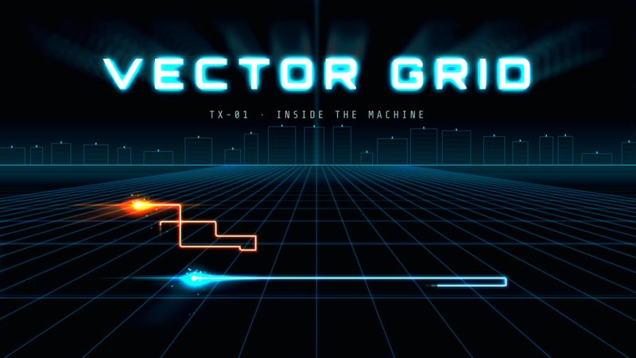{ loading=lazy }](tx-01-vector-grid.md)
**TX-01** [VECTOR GRID](tx-01-vector-grid.md)  
Neon light-lines racing across an endless dark grid.

[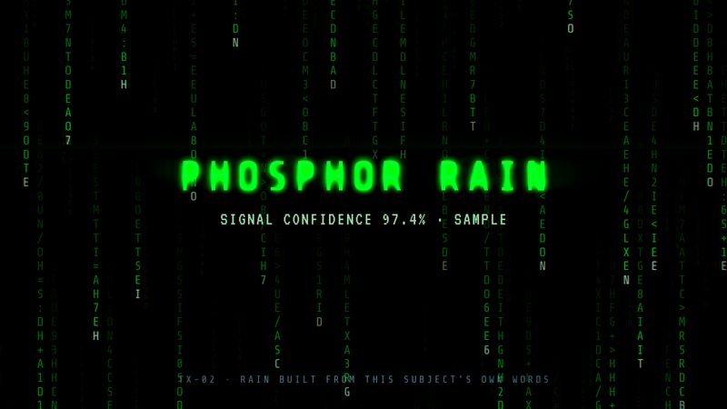{ loading=lazy }](tx-02-phosphor-rain.md)
**TX-02** [PHOSPHOR RAIN](tx-02-phosphor-rain.md)  
Green code cascading until the hidden truth resolves.

[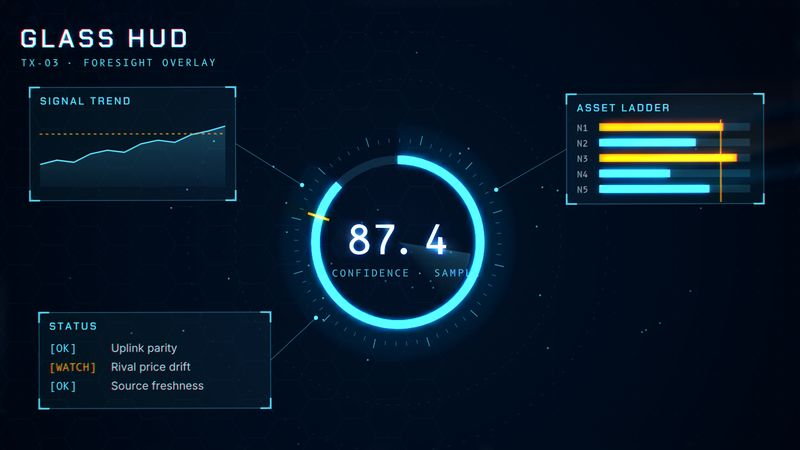{ loading=lazy }](tx-03-glass-hud.md)
**TX-03** [GLASS HUD](tx-03-glass-hud.md)  
Translucent data panels assembling around one datum.

[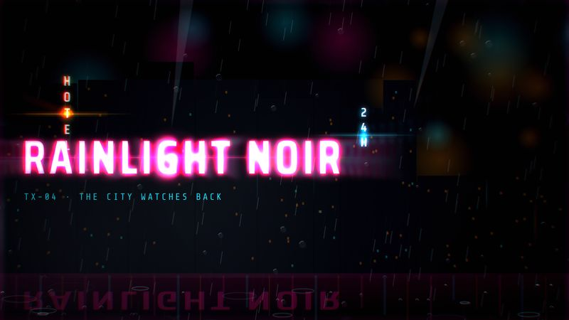{ loading=lazy }](tx-04-rainlight-noir.md)
**TX-04** [RAINLIGHT NOIR](tx-04-rainlight-noir.md)  
Rain, haze and neon reflections in a city that watches.

[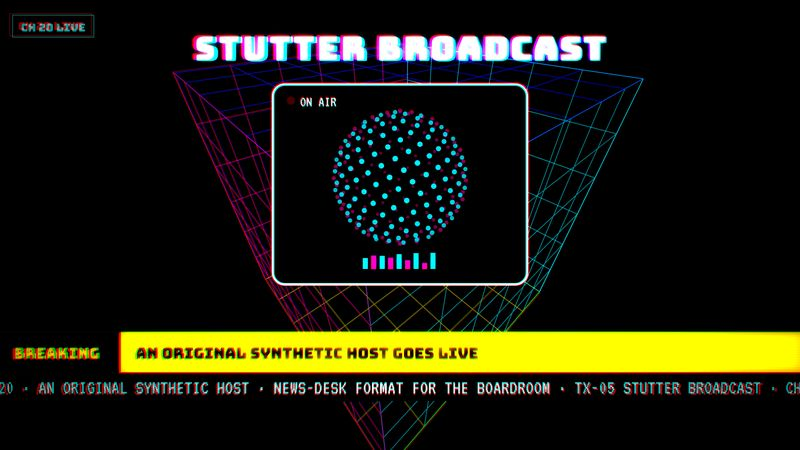{ loading=lazy }](tx-05-stutter-broadcast.md)
**TX-05** [STUTTER BROADCAST](tx-05-stutter-broadcast.md)  
A pirate-TV host stuttering through a glitching broadcast.

[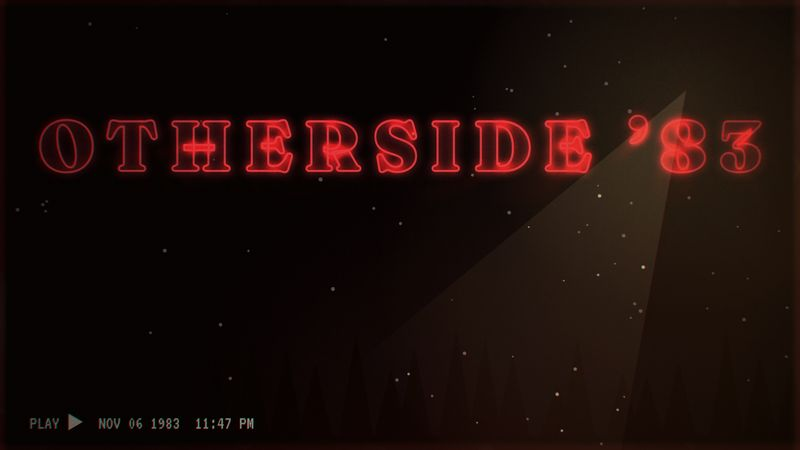{ loading=lazy }](tx-06-otherside-83.md)
**TX-06** [OTHERSIDE ’83](tx-06-otherside-83.md)  
1983 night, a red-glow title, and a world flipped under the surface.

[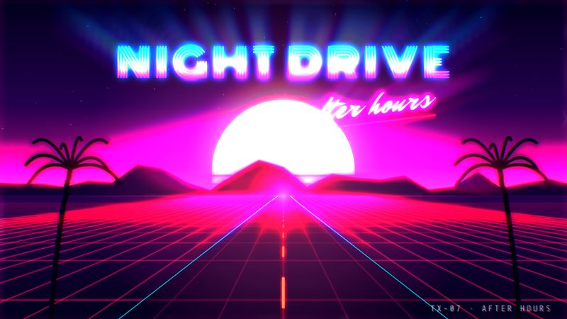{ loading=lazy }](tx-07-night-drive.md)
**TX-07** [NIGHT DRIVE](tx-07-night-drive.md)  
A pink-and-cyan night cruise toward a striped sunset.

[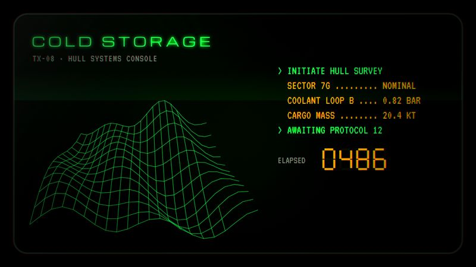{ loading=lazy }](tx-08-cold-storage.md)
**TX-08** [COLD STORAGE](tx-08-cold-storage.md)  
Chunky CRT terminals humming in a cold industrial hull.

[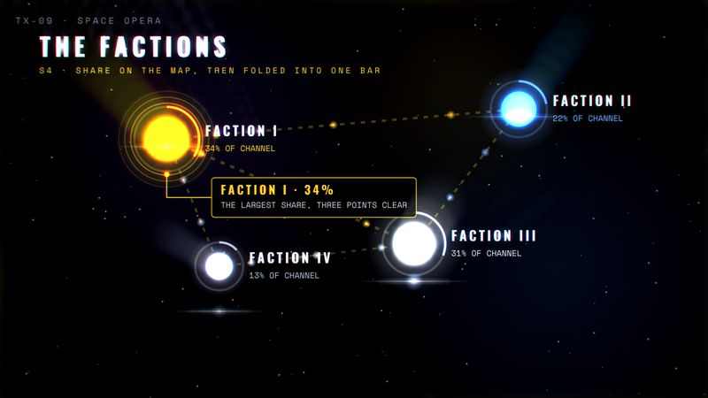{ loading=lazy }](tx-09-space-opera.md)
**TX-09** [SPACE OPERA](tx-09-space-opera.md)  
A perspective crawl, starfields and wipes at mythic scale.

[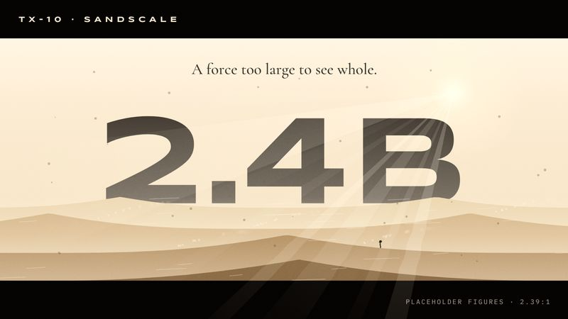{ loading=lazy }](tx-10-sandscale.md)
**TX-10** [SANDSCALE](tx-10-sandscale.md)  
Monumental forms rising from haze; tiny figures, vast forces.

[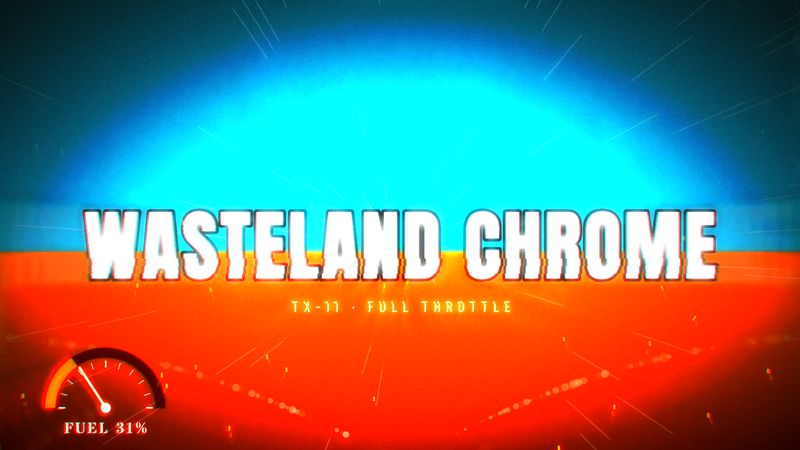{ loading=lazy }](tx-11-wasteland-chrome.md)
**TX-11** [WASTELAND CHROME](tx-11-wasteland-chrome.md)  
Orange-and-teal pursuit at full throttle, center-framed.

[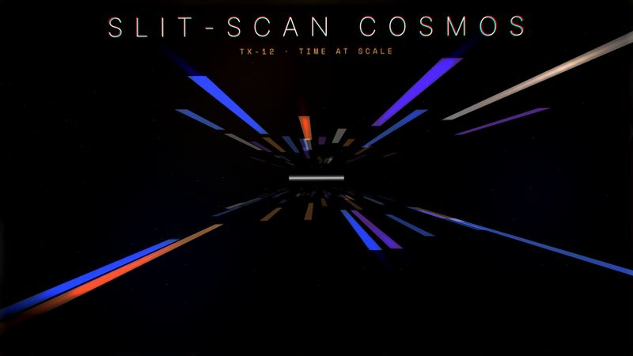{ loading=lazy }](tx-12-slit-scan-cosmos.md)
**TX-12** [SLIT-SCAN COSMOS](tx-12-slit-scan-cosmos.md)  
Light corridors, lensing rings, and silence as a beat.

[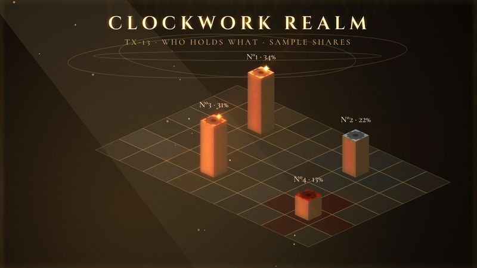{ loading=lazy }](tx-13-clockwork-realm.md)
**TX-13** [CLOCKWORK REALM](tx-13-clockwork-realm.md)  
A brass map where mechanisms rise to show who holds what.

[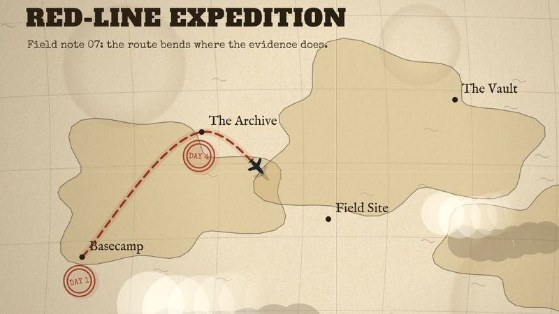{ loading=lazy }](tx-14-red-line-expedition.md)
**TX-14** [RED-LINE EXPEDITION](tx-14-red-line-expedition.md)  
A red route inking across an aged map, stamp by stamp.

[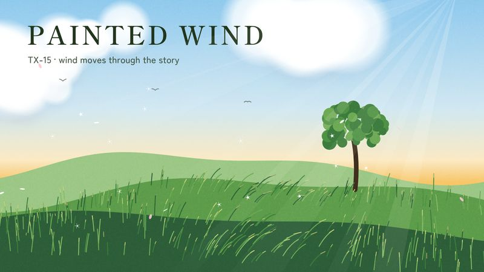{ loading=lazy }](tx-15-painted-wind.md)
**TX-15** [PAINTED WIND](tx-15-painted-wind.md)  
Hand-painted skies and wind moving through grass.

[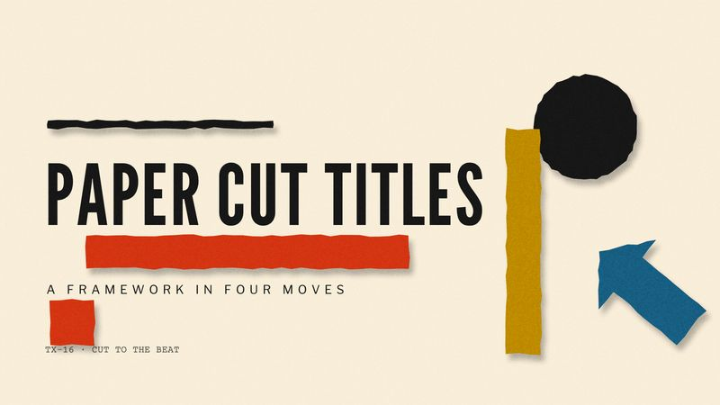{ loading=lazy }](tx-16-paper-cut-titles.md)
**TX-16** [PAPER CUT TITLES](tx-16-paper-cut-titles.md)  
Flat cut-paper shapes snapping to a jazz beat.

[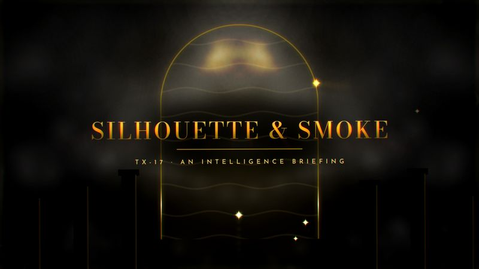{ loading=lazy }](tx-17-silhouette-smoke.md)
**TX-17** [SILHOUETTE & SMOKE](tx-17-silhouette-smoke.md)  
Gold light, silhouettes and ink-smoke morphs.

[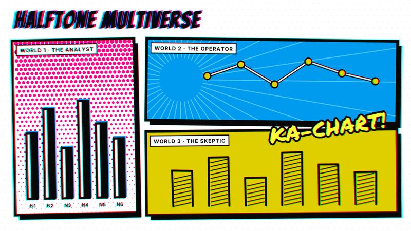{ loading=lazy }](tx-18-halftone-multiverse.md)
**TX-18** [HALFTONE MULTIVERSE](tx-18-halftone-multiverse.md)  
Comic panels, misregistered inks, one art style per world.

[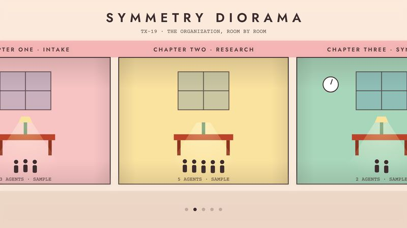{ loading=lazy }](tx-19-symmetry-diorama.md)
**TX-19** [SYMMETRY DIORAMA](tx-19-symmetry-diorama.md)  
Centered pastel dollhouse sections and whip-pan chapter cards.

[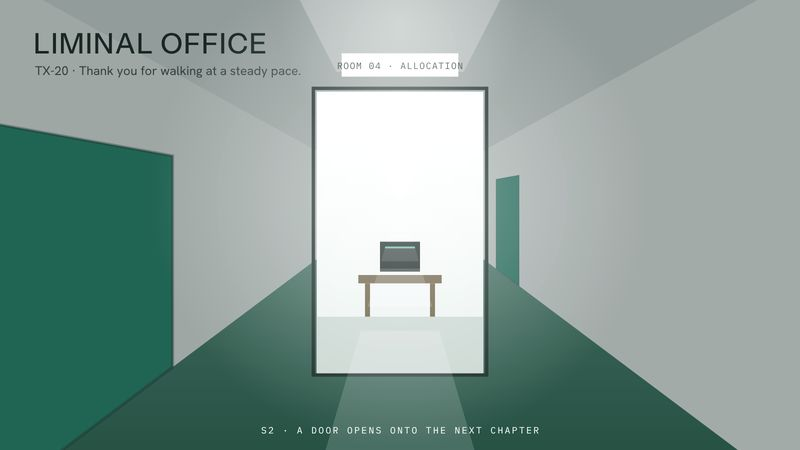{ loading=lazy }](tx-20-liminal-office.md)
**TX-20** [LIMINAL OFFICE](tx-20-liminal-office.md)  
White corridors, teal carpet, and numbers that feel uneasy.

## A · Digital Frontier

Cold light, code and interfaces. This is the family for AI, data and threat stories, and the one with the highest overlap with shipped BHIL properties, so run U3 carefully.

| ID | Codename | Feel in one line | Best for | Data shapes | Home | B2B fit |
| --- | --- | --- | --- | --- | --- | --- |
| TX-01 | [VECTOR GRID](tx-01-vector-grid.md) | Neon light-lines racing across an endless dark grid. | AI infrastructure, data flows, platform launches | flow, network | Creative | Has a Boardroom translation |
| TX-02 | [PHOSPHOR RAIN](tx-02-phosphor-rain.md) | Green code cascading until the hidden truth resolves. | Threat intel, hidden-system reveals, AI | document, network | Creative | Has a Boardroom translation |
| TX-03 | [GLASS HUD](tx-03-glass-hud.md) | Translucent data panels assembling around one datum. | Monitoring, CI dashboards, agent systems | score, comparison | B2B | Runs at Boardroom as is |
| TX-04 | [RAINLIGHT NOIR](tx-04-rainlight-noir.md) | Rain, haze and neon reflections in a city that watches. | Privacy, data brokers, AI ethics, future of work | terrain, timeline | Editorial | Has a Boardroom translation |

## B · Retro Signal

Analog screens, VHS, synths and CRTs from 1979 to 1987. This is the family for nostalgia, media and "the system is talking" stories. It carries the most flash and glitch risk, so the safety table applies in full.

| ID | Codename | Feel in one line | Best for | Data shapes | Home | B2B fit |
| --- | --- | --- | --- | --- | --- | --- |
| TX-05 | [STUTTER BROADCAST](tx-05-stutter-broadcast.md) | A pirate-TV host stuttering through a glitching broadcast. | Synthetic media, AI presenters, media disruption | timeline, comparison | Creative | Boardroom is news-desk only |
| TX-06 | [OTHERSIDE ’83](tx-06-otherside-83.md) | 1983 night, a red-glow title, and a world flipped under the surface. | Hidden risk, "under the surface" data, TTRPG, nostalgia | comparison, document | Creative | Tempered is the ceiling |
| TX-07 | [NIGHT DRIVE](tx-07-night-drive.md) | A pink-and-cyan night cruise toward a striped sunset. | Event promos, community, retro gaming | timeline, comparison | Creative | Never pitched for B2B |
| TX-08 | [COLD STORAGE](tx-08-cold-storage.md) | Chunky CRT terminals humming in a cold industrial hull. | System status, audits, monitoring, legacy tech | score, document | Editorial | Runs at Boardroom as is |

## C · Epic Cinema

Scale, myth and time. This is the family for sagas, macro forces and long-horizon strategy. Three of its four themes are B2B-capable, because gravitas reads as authority.

| ID | Codename | Feel in one line | Best for | Data shapes | Home | B2B fit |
| --- | --- | --- | --- | --- | --- | --- |
| TX-09 | [SPACE OPERA](tx-09-space-opera.md) | A perspective crawl, starfields and wipes at mythic scale. | Origin sagas, multi-part series, campaign settings | timeline, network | Creative | Tempered is the ceiling |
| TX-10 | [SANDSCALE](tx-10-sandscale.md) | Monumental forms rising from haze; tiny figures, vast forces. | Macro forces, market scale, geopolitics | terrain, comparison | B2B | Runs at Boardroom as is |
| TX-11 | [WASTELAND CHROME](tx-11-wasteland-chrome.md) | Orange-and-teal pursuit at full throttle, center-framed. | Disruption, competitive races, crisis and survival | flow, comparison | Creative | Never pitched for B2B |
| TX-12 | [SLIT-SCAN COSMOS](tx-12-slit-scan-cosmos.md) | Light corridors, lensing rings, and silence as a beat. | AI timelines, futures, keynotes on scale and time | timeline, terrain | Editorial | Runs at Boardroom as is |

## D · Worlds and Maps

Territory, journeys and landscapes. This is the family for landscapes, histories and human-centered stories. Two of its themes sit close to shipped cartographic builds, so the U3 check matters here.

| ID | Codename | Feel in one line | Best for | Data shapes | Home | B2B fit |
| --- | --- | --- | --- | --- | --- | --- |
| TX-13 | [CLOCKWORK REALM](tx-13-clockwork-realm.md) | A brass map where mechanisms rise to show who holds what. | Market landscapes, ecosystems, power maps | network, terrain | B2B | Runs at Boardroom as is |
| TX-14 | [RED-LINE EXPEDITION](tx-14-red-line-expedition.md) | A red route inking across an aged map, stamp by stamp. | Journeys, company histories, investigations, provenance | timeline, flow | Editorial | Tempered is the ceiling |
| TX-15 | [PAINTED WIND](tx-15-painted-wind.md) | Hand-painted skies and wind moving through grass. | Health and care, community, sustainability, poetry | timeline, comparison | Editorial | Tempered is the ceiling |

## E · Auteur and Title Design

Director signatures and title-sequence craft. These are the most B2B-friendly themes in the codex, because their power comes from composition and rhythm rather than spectacle.

| ID | Codename | Feel in one line | Best for | Data shapes | Home | B2B fit |
| --- | --- | --- | --- | --- | --- | --- |
| TX-16 | [PAPER CUT TITLES](tx-16-paper-cut-titles.md) | Flat cut-paper shapes snapping to a jazz beat. | Frameworks, process explainers, keynotes | flow, comparison | B2B | Runs at Boardroom as is |
| TX-17 | [SILHOUETTE & SMOKE](tx-17-silhouette-smoke.md) | Gold light, silhouettes and ink-smoke morphs. | Intelligence briefings, luxury, high-stakes launches | comparison, score | Creative | Tempered is the ceiling |
| TX-18 | [HALFTONE MULTIVERSE](tx-18-halftone-multiverse.md) | Comic panels, misregistered inks, one art style per world. | Personas, segmentation, multiple perspectives | comparison, network | Creative | Never pitched for B2B |
| TX-19 | [SYMMETRY DIORAMA](tx-19-symmetry-diorama.md) | Centered pastel dollhouse sections and whip-pan chapter cards. | Org stories, team intros, product tours | document, flow | Editorial | Runs at Boardroom as is |
| TX-20 | [LIMINAL OFFICE](tx-20-liminal-office.md) | White corridors, teal carpet, and numbers that feel uneasy. | Future of work, AI workforce, compliance | score, comparison | B2B | Runs at Boardroom as is |

## Quick picks by story type

| Story type | Try first | Then | Then |
| --- | --- | --- | --- |
| Threat and cyber intelligence | [TX-02](tx-02-phosphor-rain.md) | [TX-08](tx-08-cold-storage.md) | [TX-04](tx-04-rainlight-noir.md) |
| Market landscape or ecosystem board | [TX-13](tx-13-clockwork-realm.md) | [TX-10](tx-10-sandscale.md) | [TX-03](tx-03-glass-hud.md) |
| AI workforce and the future of work | [TX-20](tx-20-liminal-office.md) | [TX-04](tx-04-rainlight-noir.md) | [TX-05](tx-05-stutter-broadcast.md) |
| TTRPG and fan communities | [TX-06](tx-06-otherside-83.md) | [TX-09](tx-09-space-opera.md) | [TX-18](tx-18-halftone-multiverse.md) |
| Human-centered health and care | [TX-15](tx-15-painted-wind.md) | [TX-19](tx-19-symmetry-diorama.md) | [TX-16](tx-16-paper-cut-titles.md) |
| Executive keynote or briefing deck | [TX-16](tx-16-paper-cut-titles.md) | [TX-10](tx-10-sandscale.md) | [TX-12](tx-12-slit-scan-cosmos.md) |
| Events and community promos | [TX-07](tx-07-night-drive.md) | [TX-01](tx-01-vector-grid.md) | [TX-05](tx-05-stutter-broadcast.md) |

## The bench

Six alternates sketched in one line each, ready to grow into full cards when a story needs them. A bench entry graduates only with every card field, a contrast check and a homage review.

| Codename | Feel in one line | Swap in for |
| --- | --- | --- |
| SPOT-COLOR NOIR | Ink-black and white with one blood-red accent | TX-04, when a story turns on one critical variable |
| NEO-CEL | 90s cel-shaded cyberpunk, light trails, red against cyan | TX-04, for anime and creator audiences |
| ATOMIC OPTIMISM | Sunny retro-futurist ads with a dark undertone | TX-20, for promised-future-versus-reality stories |
| FOLDING CITY | Architecture folding over itself; time slowing in nested layers | TX-12, for nested-scenario and second-order-effect stories |
| RED ROOM SURREAL | Red drapes, chevron floors, backward dream logic | TX-06, for uncanny or contradictory data |
| HEX PAINTERLY | Painted 3D, graffiti, glowing crystalline tech | TX-15, for grittier creative communities |
