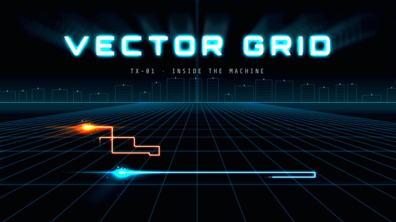

# TX-01 VECTOR GRID

<!-- Generated from canon by scripts/build_derived.py. Do not edit by hand. -->

*Neon light-lines racing across an endless dark grid.*



<div class="tx-swatches"><span class="tx-sw" style="background:#02040A" title="--tx-bg #02040A"></span><span class="tx-sw" style="background:#E6FDFF" title="--tx-ink #E6FDFF"></span><span class="tx-sw" style="background:#00E5FF" title="--tx-a1 #00E5FF"></span><span class="tx-sw" style="background:#FF6A00" title="--tx-a2 #FF6A00"></span><span class="tx-sw" style="background:#1E6F8C" title="--tx-a3 #1E6F8C"></span></div>

| Family | Home register | B2B fit | Data shapes | Best for |
| --- | --- | --- | --- | --- |
| A · Digital Frontier | Creative | Has a Boardroom translation | flow, network | AI infrastructure, data flows, platform launches |

## Tokens

Paste-ready custom properties. Download: [`tokens/themes/tx-01-vector-grid.css`](https://github.com/PolymathWizard/BHIL-Stagehand-Theme-Reel/blob/main/tokens/themes/tx-01-vector-grid.css).

```css
/* TX-01 VECTOR GRID */
:root {
  --tx-id: "TX-01";
  --tx-bg: #02040A;
  --tx-ink: #E6FDFF;
  --tx-a1: #00E5FF;
  --tx-a2: #FF6A00;
  --tx-a3: #1E6F8C;
  --tx-glow: 0 0 14px color-mix(in srgb, var(--tx-a1) 55%, transparent);
  --tx-grain: 0;
  --tx-display: "Orbitron", system-ui, sans-serif;
  --tx-body: "Exo 2", system-ui, sans-serif;
  --tx-mono: "Share Tech Mono", ui-monospace, monospace;
  --tx-display-weight: 700;
  --tx-body-weight: 400;
  --tx-mono-weight: 400;
  --tx-ease: cubic-bezier(.16,1,.3,1);
  --tx-dur: 600ms;
  --tx-step: none;
}
```

## Essence words

circuitry, speed, precision, inside the machine, rivalry, light

## Look

Black void, cyan light-lines with white-hot cores, and one orange "rival" force. One-point perspective floor grid, horizon glow, hard 90° geometry. No grain; bloom on lines only.

## Motion grammar

Constant-velocity runs that break into hard 90° turns. "Wire-in" builds go wireframe, then fill, then glow. "Shard-out" exits break into square shards. `expo.out`, 400 to 800 ms.

## Web slot map

| Slot | Name | Fill |
| --- | --- | --- |
| S1 | Hero signature | perspective grid floor scrolling toward the horizon while a light-trail draws the headline (T1 CSS 3D + gradient grid; T3 option: three.js grid with bloom). |
| S2 | Section transitions | DrawSVG light-trails linking section points at right angles. |
| S3 | Ambient layer | horizon glow + 2% scanlines. |
| S4 | Data skin | bars as glowing light-walls (scaleY only), lines as trails with a fading wake. |
| S5 | Interaction and focus | neon focus rings with circuit-trace corners. |

## Data skin

Hairline luminous strokes, no fills, mono values. The rival series is always the orange.

## Video

Cold open riding the grid at speed, cuts on 90° turns landing on downbeats, titles wiring in line by line. Arpeggiated synth with a sub pulse, 100 to 120 BPM.

## Boardroom translation

Deep navy ground, grid at 8% opacity, cyan only on the key path, no shards.

## Homage guardrails

No light-racing vehicles, throwing-disc weapons or circuit-lined suits on human figures, and no recreated title styling. Keep the light abstract: lines, grids and shards. These sit on top of the [Homage Rule](../codex/homage-rule.md).

## Collision note

Sits near sci-fi dashboard builds. Keep VECTOR GRID about motion through space, not HUD panels.

## Contrast

| Pair | Ratio | Use |
| --- | --- | --- |
| ink on ground | 19.4:1 | Body text |
| a1 on ground | 13.3:1 | Text and data lines |
| a2 on ground | 7.1:1 | Text and data lines |
| a3 on ground | 3.6:1 | Large text, icons and data lines |

## Type trio

| Role | Face | Weight | License |
| --- | --- | --- | --- |
| Display | Orbitron | 700 | OFL-1.1 |
| Body | Exo 2 | 400 | OFL-1.1 |
| Mono | Share Tech Mono | 400 | OFL-1.1 |

## In the reel

The live loop runs 22.5 s. Open it in the [reel](https://polymathwizard.github.io/BHIL-Stagehand-Theme-Reel/reel/stagehand-theme-reel.html#tx-01).

| Beat | Slot | Label | Seconds |
| --- | --- | --- | --- |
| 1 | S1 | Wire-in hero | 6 |
| 2 | S2 | Light-trail connectors | 4.5 |
| 3 | S4 | Light walls: build, insight, re-sort | 9.5 |
| 4 | S5 | Focus ring, then shard-out | 2.5 |

## Prompt seed

```text
TX-01 VECTOR GRID: inside-the-machine neon geometry; cyan light-lines on black with one orange rival; wire-in reveals, right-angle light-trail connectors, shard-out exits.
```
