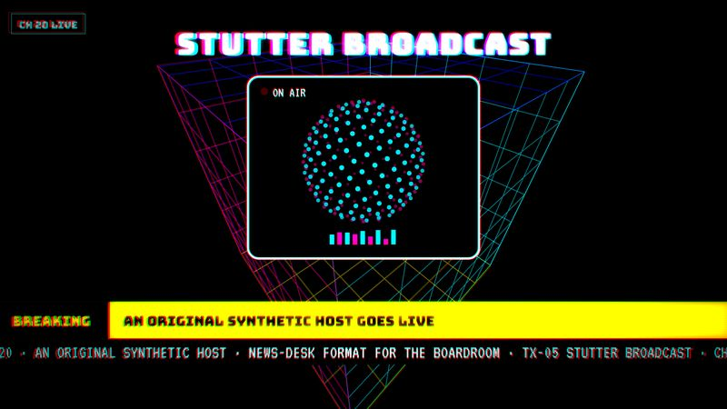

# TX-05 STUTTER BROADCAST

<!-- Generated from canon by scripts/build_derived.py. Do not edit by hand. -->

*A pirate-TV host stuttering through a glitching broadcast.*



<div class="tx-swatches"><span class="tx-sw" style="background:#000000" title="--tx-bg #000000"></span><span class="tx-sw" style="background:#FFFFFF" title="--tx-ink #FFFFFF"></span><span class="tx-sw" style="background:#FF00A8" title="--tx-a1 #FF00A8"></span><span class="tx-sw" style="background:#00F0FF" title="--tx-a2 #00F0FF"></span><span class="tx-sw" style="background:#FFE600" title="--tx-a3 #FFE600"></span></div>

| Family | Home register | B2B fit | Data shapes | Best for |
| --- | --- | --- | --- | --- |
| B · Retro Signal | Creative | Boardroom is news-desk only | timeline, comparison | Synthetic media, AI presenters, media disruption |

## Tokens

Paste-ready custom properties. Download: [`tokens/themes/tx-05-stutter-broadcast.css`](https://github.com/PolymathWizard/BHIL-Stagehand-Theme-Reel/blob/main/tokens/themes/tx-05-stutter-broadcast.css).

```css
/* TX-05 STUTTER BROADCAST */
:root {
  --tx-id: "TX-05";
  --tx-bg: #000000;
  --tx-ink: #FFFFFF;
  --tx-a1: #FF00A8;
  --tx-a2: #00F0FF;
  --tx-a3: #FFE600;
  --tx-glow: 0 0 14px color-mix(in srgb, var(--tx-a1) 55%, transparent);
  --tx-grain: .05;
  --tx-display: "Bungee", system-ui, sans-serif;
  --tx-body: "Space Grotesk", system-ui, sans-serif;
  --tx-mono: "VT323", ui-monospace, monospace;
  --tx-display-weight: 400;
  --tx-body-weight: 400;
  --tx-mono-weight: 400;
  --tx-ease: cubic-bezier(.2,0,0,1);
  --tx-dur: 350ms;
  --tx-step: steps(3);
}
```

## Essence words

broadcast, synthetic host, satire, interruption, media control, glitch

## Look

Black studio void behind a rotating box of colored lines. Saturated magenta, cyan, yellow and electric blue; scanlines; generic test-card bars. An "on-air" frame: a central presenter window, a lower-third chyron, an original station bug in the corner.

## Motion grammar

The stutter-repeat. A word or frame repeats 2 to 3 times with a jitter before it lands ("re-re-revenue"). Frame holds, channel-change cuts with 200 ms of static at most, a tracking band rolling through.

## Web slot map

| Slot | Name | Fill |
| --- | --- | --- |
| S1 | Hero signature | rotating line-box backdrop (CSS 3D, T1 to T2) behind an on-air frame, with the headline stuttering in. |
| S2 | Section transitions | stutter-repeat reveals on section heads; the repeats sit in `aria-hidden` spans and the real text appears once. |
| S3 | Ambient layer | scanlines + 2 px chroma offset. |
| S4 | Data skin | charts "change channel" between states (crossfade + 150 ms noise). |
| S5 | Interaction and focus | a LIVE bug and chyron-style hovers. |

## Data skin

Flat primary bars on black, VT323 tickers, key numbers delivered as "breaking" chyrons.

## Video

News-desk framing, a presenter cut off by interruptions, stutter edits on the beat, interlace artifacts, a 4:3 frame inside 16:9. Synth-pop at 110 to 120 BPM, chopped vocal stabs (original), short static stings.

## Boardroom translation

News-desk format only: chyrons, lower thirds, a ticker and clean cuts. No stutter, glitch or chroma.

## Homage guardrails

No recreation of an existing synthetic presenter's face, hair, wardrobe or name, and no lines from any show. Any AI host must be an original design. These sit on top of the [Homage Rule](../codex/homage-rule.md).

## Collision note

Sits near host-led stories. The natural home for AI presenters, avatars and synthetic-media stories.

## Contrast

| Pair | Ratio | Use |
| --- | --- | --- |
| ink on ground | 21.0:1 | Body text |
| a1 on ground | 5.8:1 | Text and data lines |
| a2 on ground | 14.9:1 | Text and data lines |
| a3 on ground | 16.6:1 | Text and data lines |

## Type trio

| Role | Face | Weight | License |
| --- | --- | --- | --- |
| Display | Bungee | 400 | OFL-1.1 |
| Body | Space Grotesk | 400 | OFL-1.1 |
| Mono | VT323 | 400 | OFL-1.1 |

## In the reel

The live loop runs 22.5 s. Open it in the [reel](https://polymathwizard.github.io/BHIL-Stagehand-Theme-Reel/reel/stagehand-theme-reel.html#tx-05).

| Beat | Slot | Label | Seconds |
| --- | --- | --- | --- |
| 1 | S1 | On air | 5 |
| 2 | S2 | Stutter headline | 4 |
| 3 | S4 | Three channels, three insights | 9.5 |
| 4 | S5 | Chyron and ticker | 4 |

## Prompt seed

```text
TX-05 STUTTER BROADCAST: a pirate-TV broadcast fronted by an original synthetic host; stutter-repeat headlines; channel-change data transitions; chyrons for every key number.
```
