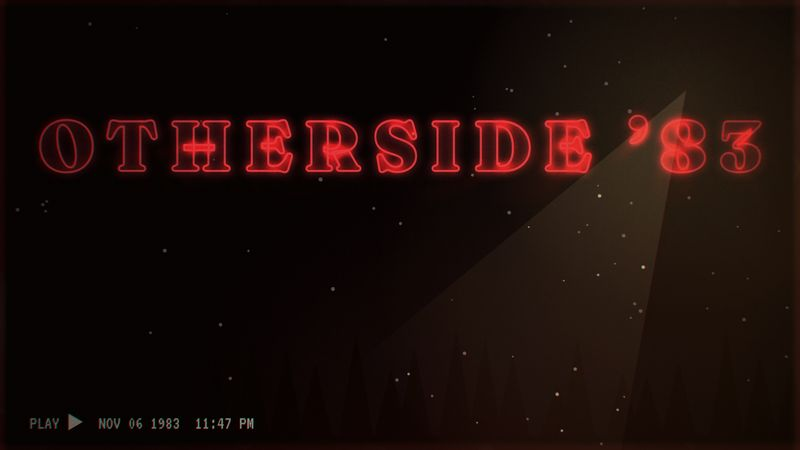

# TX-06 OTHERSIDE ’83

<!-- Generated from canon by scripts/build_derived.py. Do not edit by hand. -->

*1983 night, a red-glow title, and a world flipped under the surface.*



<div class="tx-swatches"><span class="tx-sw" style="background:#070608" title="--tx-bg #070608"></span><span class="tx-sw" style="background:#F2E6C9" title="--tx-ink #F2E6C9"></span><span class="tx-sw" style="background:#E0303A" title="--tx-a1 #E0303A"></span><span class="tx-sw" style="background:#8DA3B5" title="--tx-a2 #8DA3B5"></span><span class="tx-sw" style="background:#FF5A4E" title="--tx-a3 #FF5A4E"></span></div>

| Family | Home register | B2B fit | Data shapes | Best for |
| --- | --- | --- | --- | --- |
| B · Retro Signal | Creative | Tempered is the ceiling | comparison, document | Hidden risk, "under the surface" data, TTRPG, nostalgia |

## Tokens

Paste-ready custom properties. Download: [`tokens/themes/tx-06-otherside-83.css`](https://github.com/PolymathWizard/BHIL-Stagehand-Theme-Reel/blob/main/tokens/themes/tx-06-otherside-83.css).

```css
/* TX-06 OTHERSIDE ’83 */
:root {
  --tx-id: "TX-06";
  --tx-bg: #070608;
  --tx-ink: #F2E6C9;
  --tx-a1: #E0303A;
  --tx-a2: #8DA3B5;
  --tx-a3: #FF5A4E;
  --tx-glow: 0 0 14px color-mix(in srgb, var(--tx-a1) 55%, transparent);
  --tx-grain: .10;
  --tx-display: "Fraunces", system-ui, sans-serif;
  --tx-body: "Crimson Pro", system-ui, sans-serif;
  --tx-mono: "VT323", ui-monospace, monospace;
  --tx-display-weight: 900;
  --tx-body-weight: 400;
  --tx-mono-weight: 400;
  --tx-ease: cubic-bezier(.37,0,.63,1);
  --tx-dur: 1400ms;
  --tx-step: none;
}
```

## Essence words

nostalgia, dread, hidden world, friendship, small town, signal

## Look

A 1983 night: blue-black, a crimson title glow, warm practical lamps, cream paper. Display is Fraunces at weight 900, tightly tracked, outlined, with a red outer glow; it reads as 80s paperback, not as any franchise's lockup. The "flipped" chapter goes desaturated blue-grey with drifting ash. VHS noise stays at 8% or less over text.

## Motion grammar

A slow title assembly where letters drift together and kern tight over 3 to 4 s. VHS tracking-roll between chapters, flashlight reveals in dark sections, particles drifting slowly upward.

## Web slot map

| Slot | Name | Fill |
| --- | --- | --- |
| S1 | Hero signature | the title assembly in glowing outlined serif over a dark field (T1 to T2; no autoplay audio). |
| S2 | Section transitions | VHS tracking-roll transitions (clip + offset, 300 ms or less). |
| S3 | Ambient layer | floating ash (tsParticles slim, 40 desktop / 20 mobile) + film grain. |
| S4 | Data skin | charts as 80s graph-paper plots and photocopied handouts; the flipped chapter shows the same chart with the hidden variable revealed. |
| S5 | Interaction and focus | a flashlight spotlight cursor, gated to `(hover:hover)`; touch gets a static vignette. |

## Data skin

Two-worlds comparisons, surface versus underneath. "Hidden" series are dashed until the flip.

## Video

A slow push on the title, analog synth arpeggios at 80 to 100 BPM, dissolves, practical-light flicker under 3 per second.

## Boardroom translation

Tempered is the ceiling. Keep the two-worlds device and palette; drop the VHS roll and the flashlight cursor.

## Homage guardrails

No series title lockup or its typeface, no creatures or characters, no alphabet-light wall, no named town or lab, no kids-on-bikes silhouettes. These sit on top of the [Homage Rule](../codex/homage-rule.md).

## Collision note

Sits near dark case-file looks. A strong fit for TTRPG work and for 'what's under the surface' risk stories.

## Contrast

| Pair | Ratio | Use |
| --- | --- | --- |
| ink on ground | 16.3:1 | Body text |
| a1 on ground | 4.5:1 | Large text, icons and data lines |
| a2 on ground | 7.7:1 | Text and data lines |
| a3 on ground | 6.6:1 | Text and data lines |

## Type trio

| Role | Face | Weight | License |
| --- | --- | --- | --- |
| Display | Fraunces | 900 | OFL-1.1 |
| Body | Crimson Pro | 400 | OFL-1.1 |
| Mono | VT323 | 400 | OFL-1.1 |

## In the reel

The live loop runs 22.5 s. Open it in the [reel](https://polymathwizard.github.io/BHIL-Stagehand-Theme-Reel/reel/stagehand-theme-reel.html#tx-06).

| Beat | Slot | Label | Seconds |
| --- | --- | --- | --- |
| 1 | S1 | Title assembly | 6 |
| 2 | S2 | VHS roll to chapter | 3.5 |
| 3 | S4 | Two worlds: scrub, gap, the turn | 9.5 |
| 4 | S5 | Flashlight reveal | 3.5 |

## Prompt seed

```text
TX-06 OTHERSIDE ’83: a 1983-night story with a glowing serif title; every key chart has a flipped 'other side' that reveals the hidden variable; ash drifts, VHS rolls between chapters.
```
