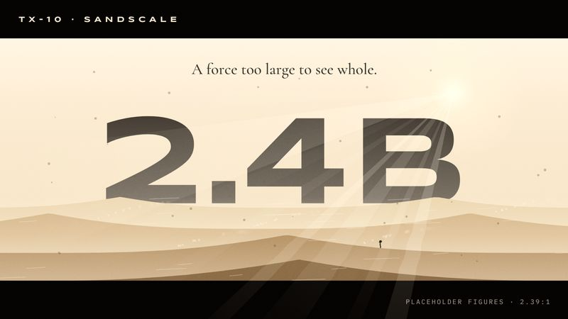

# TX-10 SANDSCALE

<!-- Generated from canon by scripts/build_derived.py. Do not edit by hand. -->

*Monumental forms rising from haze; tiny figures, vast forces.*



<div class="tx-swatches"><span class="tx-sw" style="background:#F3E9DA" title="--tx-bg #F3E9DA"></span><span class="tx-sw" style="background:#2B2620" title="--tx-ink #2B2620"></span><span class="tx-sw" style="background:#9A4A1C" title="--tx-a1 #9A4A1C"></span><span class="tx-sw" style="background:#6E5536" title="--tx-a2 #6E5536"></span><span class="tx-sw" style="background:#0E0E0E" title="--tx-a3 #0E0E0E"></span></div>

| Family | Home register | B2B fit | Data shapes | Best for |
| --- | --- | --- | --- | --- |
| C · Epic Cinema | B2B | Runs at Boardroom as is | terrain, comparison | Macro forces, market scale, geopolitics |

## Tokens

Paste-ready custom properties. Download: [`tokens/themes/tx-10-sandscale.css`](https://github.com/PolymathWizard/BHIL-Stagehand-Theme-Reel/blob/main/tokens/themes/tx-10-sandscale.css).

```css
/* TX-10 SANDSCALE */
:root {
  --tx-id: "TX-10";
  --tx-bg: #F3E9DA;
  --tx-ink: #2B2620;
  --tx-a1: #9A4A1C;
  --tx-a2: #6E5536;
  --tx-a3: #0E0E0E;
  --tx-glow: 0 0 14px color-mix(in srgb, var(--tx-a1) 55%, transparent);
  --tx-grain: .06;
  --tx-display: "Syncopate", system-ui, sans-serif;
  --tx-body: "Cormorant Garamond", system-ui, sans-serif;
  --tx-mono: "IBM Plex Mono", ui-monospace, monospace;
  --tx-display-weight: 700;
  --tx-body-weight: 500;
  --tx-mono-weight: 400;
  --tx-ease: cubic-bezier(.65,0,.35,1);
  --tx-dur: 2200ms;
  --tx-step: none;
}
```

## Essence words

scale, endurance, power, scarcity, prophecy, gravity

## Look

A light theme: pale haze ground, sand ochre, basalt shadow, one ember accent. Extreme scale contrast, with a tiny human-scale marker against a massive form. 2.39:1 letterbox, heavy negative space, Syncopate in widely spaced caps. An "infrared" chapter switches to high-key black and white for the threat or antagonist data.

## Motion grammar

Slow and heavy: 1.5 to 3 s, `power2.inOut`. Forms rise out of haze; sand-sweep wipes through noise masks; light camera shake on the S1 only.

## Web slot map

| Slot | Name | Fill |
| --- | --- | --- |
| S1 | Hero signature | a monumental reveal: a ridge, a structure or the key number at architectural scale rising from layered haze above a tiny marker (layered parallax, T1 to T2). |
| S2 | Section transitions | sand-sweep noise-mask wipes. |
| S3 | Ambient layer | drifting particulate (30 max) + static heat shimmer. |
| S4 | Data skin | bars as textured stone slabs, contour terrain charts for distributions, tiny figures for per-capita comparisons. |
| S5 | Interaction and focus | restrained. |

## Data skin

Slabs, contours and scale figures. Every comparison is drawn at true proportion.

## Video

Extreme wides, slow pushes, silhouettes on ridgelines, long holds. Sub-bass drones and low choral textures.

## Boardroom translation

Native. Cap haze at 3 layers.

## Homage guardrails

No giant worms, desert survival suits, flapping-wing aircraft, noble-house sigils, invented resource names or glyph alphabets, and no custom wordmark. No black monolith slab either; that belongs to TX-12's genre. These sit on top of the [Homage Rule](../codex/homage-rule.md).

## Collision note

Sits near contour-terrain builds. Avoid a contour-terrain S1 if one is among the last two builds.

## Contrast

| Pair | Ratio | Use |
| --- | --- | --- |
| ink on ground | 12.5:1 | Body text |
| a1 on ground | 5.2:1 | Text and data lines |
| a2 on ground | 5.8:1 | Text and data lines |
| a3 on ground | 16.1:1 | Text and data lines |

## Type trio

| Role | Face | Weight | License |
| --- | --- | --- | --- |
| Display | Syncopate | 700 | Apache-2.0 |
| Body | Cormorant Garamond | 500 | OFL-1.1 |
| Mono | IBM Plex Mono | 400 | OFL-1.1 |

## In the reel

The live loop runs 23.5 s. Open it in the [reel](https://polymathwizard.github.io/BHIL-Stagehand-Theme-Reel/reel/stagehand-theme-reel.html#tx-10).

| Beat | Slot | Label | Seconds |
| --- | --- | --- | --- |
| 1 | S1 | Monumental rise | 7 |
| 2 | S2 | Sand-sweep wipe | 3 |
| 3 | S4 | Stone slabs: tallest, average, order | 9.5 |
| 4 | S2 | Infrared chapter | 4 |

## Prompt seed

```text
TX-10 SANDSCALE: forces too large to see whole; the key number rises from haze at architectural scale over a tiny human marker; slow, heavy, ochre; an infrared chapter for the threat.
```
