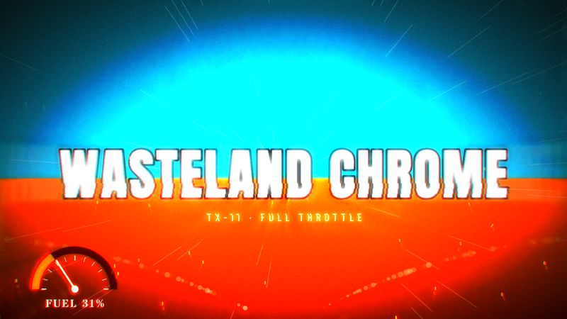

# TX-11 WASTELAND CHROME

<!-- Generated from canon by scripts/build_derived.py. Do not edit by hand. -->

*Orange-and-teal pursuit at full throttle, center-framed.*



<div class="tx-swatches"><span class="tx-sw" style="background:#0A0A0A" title="--tx-bg #0A0A0A"></span><span class="tx-sw" style="background:#F2E6D0" title="--tx-ink #F2E6D0"></span><span class="tx-sw" style="background:#FF7A1A" title="--tx-a1 #FF7A1A"></span><span class="tx-sw" style="background:#1FB5C9" title="--tx-a2 #1FB5C9"></span><span class="tx-sw" style="background:#C9C9C9" title="--tx-a3 #C9C9C9"></span></div>

| Family | Home register | B2B fit | Data shapes | Best for |
| --- | --- | --- | --- | --- |
| C · Epic Cinema | Creative | Never pitched for B2B | flow, comparison | Disruption, competitive races, crisis and survival |

## Tokens

Paste-ready custom properties. Download: [`tokens/themes/tx-11-wasteland-chrome.css`](https://github.com/PolymathWizard/BHIL-Stagehand-Theme-Reel/blob/main/tokens/themes/tx-11-wasteland-chrome.css).

```css
/* TX-11 WASTELAND CHROME */
:root {
  --tx-id: "TX-11";
  --tx-bg: #0A0A0A;
  --tx-ink: #F2E6D0;
  --tx-a1: #FF7A1A;
  --tx-a2: #1FB5C9;
  --tx-a3: #C9C9C9;
  --tx-glow: 0 0 14px color-mix(in srgb, var(--tx-a1) 55%, transparent);
  --tx-grain: .10;
  --tx-display: "Anton", system-ui, sans-serif;
  --tx-body: "Barlow Condensed", system-ui, sans-serif;
  --tx-mono: "Stardos Stencil", ui-monospace, monospace;
  --tx-display-weight: 400;
  --tx-body-weight: 500;
  --tx-mono-weight: 700;
  --tx-ease: cubic-bezier(.87,0,.13,1);
  --tx-dur: 250ms;
  --tx-step: steps(8);
}
```

## Essence words

velocity, scarcity, rivalry, escape, fury, machinery

## Look

Burnt-orange desert, teal sky, crushed blacks, chrome highlights, dust. A day-for-night blue chapter. Subjects sit dead center so the eye never hunts during fast cuts.

## Motion grammar

Crash zooms (scale 1.3 to 1 in 250 ms), stepped "under-cranked" bursts (`steps(8)`), then sudden slow-motion holds; diagonal dust bursts.

## Web slot map

| Slot | Name | Fill |
| --- | --- | --- |
| S1 | Hero signature | a scroll-scrubbed charge: speed lines and dust converge on a center-framed headline (canvas, T2 to T3). |
| S2 | Section transitions | crash-zoom section reveals with pre-baked motion blur. |
| S3 | Ambient layer | dust and grit overlay at 8% or less. |
| S4 | Data skin | gauge needles, warning-stencil labels, heat-scorch maps. |
| S5 | Interaction and focus | stencil-stamp hovers. |

## Data skin

Gauges and needles, stencil labels, orange versus teal for rivals.

## Video

Rapid cutting with centered eye-trace, an orange-teal grade, speed ramps, war-drum percussion at 140 BPM or faster.

## Boardroom translation

Avoid. For editorial work, Tempered keeps the palette and center framing and drops the stepped bursts.

## Homage guardrails

No war-convoy vehicles, skull-and-wheel or faction emblems, characters, masks, flame-throwing guitars, or franchise names. These sit on top of the [Homage Rule](../codex/homage-rule.md).

## Collision note

Clear. Good for disruption and race narratives, crisis-and-survival stories and sales-kickoff energy.

## Contrast

| Pair | Ratio | Use |
| --- | --- | --- |
| ink on ground | 16.0:1 | Body text |
| a1 on ground | 7.6:1 | Text and data lines |
| a2 on ground | 8.0:1 | Text and data lines |
| a3 on ground | 12.0:1 | Text and data lines |

## Type trio

| Role | Face | Weight | License |
| --- | --- | --- | --- |
| Display | Anton | 400 | OFL-1.1 |
| Body | Barlow Condensed | 500 | OFL-1.1 |
| Mono | Stardos Stencil | 700 | OFL-1.1 |

## In the reel

The live loop runs 22.5 s. Open it in the [reel](https://polymathwizard.github.io/BHIL-Stagehand-Theme-Reel/reel/stagehand-theme-reel.html#tx-11).

| Beat | Slot | Label | Seconds |
| --- | --- | --- | --- |
| 1 | S1 | Crash-zoom title | 5 |
| 2 | S2 | Speed-ramp section slam | 4 |
| 3 | S4 | Rival race: gap, then laps | 9.5 |
| 4 | S1 | Slow-mo decisive number | 4 |

## Prompt seed

```text
TX-11 WASTELAND CHROME: a full-throttle chase for scarce advantage; center-framed crash zooms; stencil-labeled gauges; orange versus teal rivals; sudden slow-motion on the decisive number.
```
