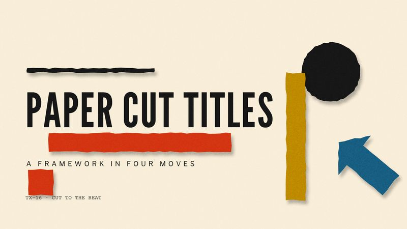

# TX-16 PAPER CUT TITLES

<!-- Generated from canon by scripts/build_derived.py. Do not edit by hand. -->

*Flat cut-paper shapes snapping to a jazz beat.*



<div class="tx-swatches"><span class="tx-sw" style="background:#F2E8D5" title="--tx-bg #F2E8D5"></span><span class="tx-sw" style="background:#1C1C1C" title="--tx-ink #1C1C1C"></span><span class="tx-sw" style="background:#C93A1B" title="--tx-a1 #C93A1B"></span><span class="tx-sw" style="background:#1F5F7F" title="--tx-a2 #1F5F7F"></span><span class="tx-sw" style="background:#B88A00" title="--tx-a3 #B88A00"></span></div>

| Family | Home register | B2B fit | Data shapes | Best for |
| --- | --- | --- | --- | --- |
| E · Auteur and Title Design | B2B | Runs at Boardroom as is | flow, comparison | Frameworks, process explainers, keynotes |

## Tokens

Paste-ready custom properties. Download: [`tokens/themes/tx-16-paper-cut-titles.css`](https://github.com/PolymathWizard/BHIL-Stagehand-Theme-Reel/blob/main/tokens/themes/tx-16-paper-cut-titles.css).

```css
/* TX-16 PAPER CUT TITLES */
:root {
  --tx-id: "TX-16";
  --tx-bg: #F2E8D5;
  --tx-ink: #1C1C1C;
  --tx-a1: #C93A1B;
  --tx-a2: #1F5F7F;
  --tx-a3: #B88A00;
  --tx-glow: 0 0 14px color-mix(in srgb, var(--tx-a1) 55%, transparent);
  --tx-grain: .08;
  --tx-display: "League Gothic", system-ui, sans-serif;
  --tx-body: "Libre Franklin", system-ui, sans-serif;
  --tx-mono: "Courier Prime", ui-monospace, monospace;
  --tx-display-weight: 400;
  --tx-body-weight: 400;
  --tx-mono-weight: 400;
  --tx-ease: cubic-bezier(.76,0,.24,1);
  --tx-dur: 320ms;
  --tx-step: steps(4);
}
```

## Essence words

rhythm, clarity, modernism, persuasion, structure, wit

## Look

Warm paper, vermilion, black, mustard, teal. Flat shapes with hand-cut jagged edges, bold diagonals, big negative space, asymmetric balance. No gradients.

## Motion grammar

Syncopated. Shapes snap on the beat, hold, then snap again. Bars slide in like cut strips, and each shape transforms into the next section's form.

## Web slot map

| Slot | Name | Fill |
| --- | --- | --- |
| S1 | Hero signature | cut-paper shapes assemble into the headline in a jazz-timed sequence (SVG + GSAP; jagged edges from an feTurbulence displacement baked once, never animated). |
| S2 | Section transitions | hard-edged shape wipes. |
| S3 | Ambient layer | paper texture. |
| S4 | Data skin | bars as cut strips, pies as paper wedges, arrows as cut shards. |
| S5 | Interaction and focus | shapes nudge on hover. |

## Data skin

Flat fills, one accent per chart, labels set in condensed caps.

## Video

Title-sequence grammar: every cut on the beat, shapes morphing into the next frame, original swing jazz with brass stabs at 120 to 140 BPM.

## Boardroom translation

Native, and one of the strongest B2B themes. Slow the rhythm to 600 to 900 ms.

## Homage guardrails

No recreations of specific title sequences or posters (a famous spiral, a falling-businessman silhouette, a fragmented-figure layout), and no film titles. These sit on top of the [Homage Rule](../codex/homage-rule.md).

## Collision note

Clear. Ideal for frameworks, process explainers, marketing strategy and briefing decks.

## Contrast

| Pair | Ratio | Use |
| --- | --- | --- |
| ink on ground | 14.0:1 | Body text |
| a1 on ground | 4.2:1 | Large text, icons and data lines |
| a2 on ground | 5.8:1 | Text and data lines |
| a3 on ground | 2.6:1 | Fill only |

## Type trio

| Role | Face | Weight | License |
| --- | --- | --- | --- |
| Display | League Gothic | 400 | OFL-1.1 |
| Body | Libre Franklin | 400 | OFL-1.1 |
| Mono | Courier Prime | 400 | OFL-1.1 |

## In the reel

The live loop runs 22.5 s. Open it in the [reel](https://polymathwizard.github.io/BHIL-Stagehand-Theme-Reel/reel/stagehand-theme-reel.html#tx-16).

| Beat | Slot | Label | Seconds |
| --- | --- | --- | --- |
| 1 | S1 | Shapes assemble to the beat | 6 |
| 2 | S2 | Shapes become the diagram | 4.5 |
| 3 | S4 | Cut strips re-cut on the beat | 9.5 |
| 4 | S5 | Nudge and tag | 2.5 |

## Prompt seed

```text
TX-16 PAPER CUT TITLES: the framework told in flat cut-paper shapes that snap to a jazz beat; every shape becomes the next section's diagram; vermilion on warm paper.
```
