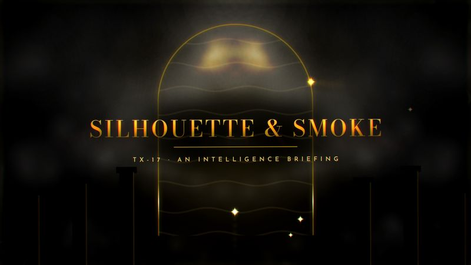

# TX-17 SILHOUETTE & SMOKE

<!-- Generated from canon by scripts/build_derived.py. Do not edit by hand. -->

*Gold light, silhouettes and ink-smoke morphs.*



<div class="tx-swatches"><span class="tx-sw" style="background:#050505" title="--tx-bg #050505"></span><span class="tx-sw" style="background:#EDE6D6" title="--tx-ink #EDE6D6"></span><span class="tx-sw" style="background:#C9A227" title="--tx-a1 #C9A227"></span><span class="tx-sw" style="background:#A3262A" title="--tx-a2 #A3262A"></span><span class="tx-sw" style="background:#F0D27A" title="--tx-a3 #F0D27A"></span></div>

| Family | Home register | B2B fit | Data shapes | Best for |
| --- | --- | --- | --- | --- |
| E · Auteur and Title Design | Creative | Tempered is the ceiling | comparison, score | Intelligence briefings, luxury, high-stakes launches |

## Tokens

Paste-ready custom properties. Download: [`tokens/themes/tx-17-silhouette-smoke.css`](https://github.com/PolymathWizard/BHIL-Stagehand-Theme-Reel/blob/main/tokens/themes/tx-17-silhouette-smoke.css).

```css
/* TX-17 SILHOUETTE & SMOKE */
:root {
  --tx-id: "TX-17";
  --tx-bg: #050505;
  --tx-ink: #EDE6D6;
  --tx-a1: #C9A227;
  --tx-a2: #A3262A;
  --tx-a3: #F0D27A;
  --tx-glow: 0 0 14px color-mix(in srgb, var(--tx-a1) 55%, transparent);
  --tx-grain: .04;
  --tx-display: "Bodoni Moda", system-ui, sans-serif;
  --tx-body: "Cormorant Garamond", system-ui, sans-serif;
  --tx-mono: "Josefin Sans", ui-monospace, monospace;
  --tx-display-weight: 500;
  --tx-body-weight: 500;
  --tx-mono-weight: 600;
  --tx-ease: cubic-bezier(.65,0,.35,1);
  --tx-dur: 1500ms;
  --tx-step: none;
}
```

## Essence words

intrigue, elegance, danger, secrecy, seduction, precision

## Look

Black, gold, oxblood, smoke white, midnight blue. Silhouettes of abstract forms, hands and architecture against light; mirrored kaleidoscope frames; Didone display type with widely spaced caps.

## Motion grammar

Liquid. Slow-motion ink and smoke flows, blob morphs between sections, kaleidoscopic mirror openers. 1 to 2 s, `power2.inOut`.

## Web slot map

| Slot | Name | Fill |
| --- | --- | --- |
| S1 | Hero signature | smoke or ink flowing through a gold-lit frame to reveal the title (VFX-JS fluid at FULL only; poster + MorphSVG at TEMPERED). |
| S2 | Section transitions | liquid MorphSVG transitions. |
| S3 | Ambient layer | slow smoke drift. |
| S4 | Data skin | thin gold line charts on black with Didone numerals. |
| S5 | Interaction and focus | gold underline sweeps. |

## Data skin

Hairline gold, generous whitespace, Didone numerals.

## Video

Slow-motion liquids, silhouettes, mirrored frames, and an original orchestral ballad feel with brass.

## Boardroom translation

Tempered is the ceiling: gold-on-black luxury minimalism with no fluid sim (WebGL fluid never runs in B2B).

## Homage guardrails

No gun-barrel opening, agent-number marks, firearm silhouettes, character names, theme melody or sound-alikes. These sit on top of the [Homage Rule](../codex/homage-rule.md).

## Collision note

Sits near espionage dossiers and briefing builds. Never use it within two builds of either.

## Contrast

| Pair | Ratio | Use |
| --- | --- | --- |
| ink on ground | 16.4:1 | Body text |
| a1 on ground | 8.4:1 | Text and data lines |
| a2 on ground | 2.8:1 | Fill only |
| a3 on ground | 13.8:1 | Text and data lines |

## Type trio

| Role | Face | Weight | License |
| --- | --- | --- | --- |
| Display | Bodoni Moda | 500 | OFL-1.1 |
| Body | Cormorant Garamond | 500 | OFL-1.1 |
| Mono | Josefin Sans | 600 | OFL-1.1 |

## In the reel

The live loop runs 22.5 s. Open it in the [reel](https://polymathwizard.github.io/BHIL-Stagehand-Theme-Reel/reel/stagehand-theme-reel.html#tx-17).

| Beat | Slot | Label | Seconds |
| --- | --- | --- | --- |
| 1 | S1 | Smoke reveals the title | 6 |
| 2 | S2 | Liquid morph to chapter | 4 |
| 3 | S4 | Gold line: extremes, growth, ledger | 9.5 |
| 4 | S5 | Underline sweep | 3 |

## Prompt seed

```text
TX-17 SILHOUETTE & SMOKE: an intelligence briefing opened like a title sequence; ink and smoke reveal each finding in gold light; Didone numerals; slow, liquid, exact.
```
