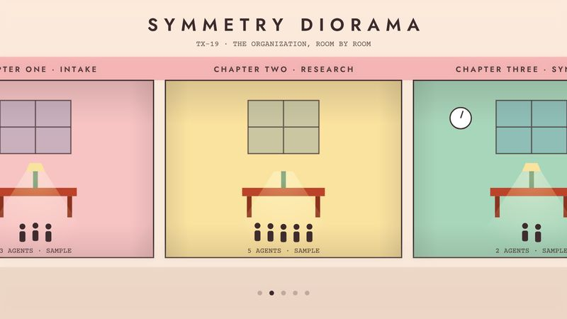

# TX-19 SYMMETRY DIORAMA

<!-- Generated from canon by scripts/build_derived.py. Do not edit by hand. -->

*Centered pastel dollhouse sections and whip-pan chapter cards.*



<div class="tx-swatches"><span class="tx-sw" style="background:#F7E8DC" title="--tx-bg #F7E8DC"></span><span class="tx-sw" style="background:#3C2B2D" title="--tx-ink #3C2B2D"></span><span class="tx-sw" style="background:#B5452B" title="--tx-a1 #B5452B"></span><span class="tx-sw" style="background:#4F7FA6" title="--tx-a2 #4F7FA6"></span><span class="tx-sw" style="background:#3F7D5C" title="--tx-a3 #3F7D5C"></span></div>

| Family | Home register | B2B fit | Data shapes | Best for |
| --- | --- | --- | --- | --- |
| E · Auteur and Title Design | Editorial | Runs at Boardroom as is | document, flow | Org stories, team intros, product tours |

## Tokens

Paste-ready custom properties. Download: [`tokens/themes/tx-19-symmetry-diorama.css`](https://github.com/PolymathWizard/BHIL-Stagehand-Theme-Reel/blob/main/tokens/themes/tx-19-symmetry-diorama.css).

```css
/* TX-19 SYMMETRY DIORAMA */
:root {
  --tx-id: "TX-19";
  --tx-bg: #F7E8DC;
  --tx-ink: #3C2B2D;
  --tx-a1: #B5452B;
  --tx-a2: #4F7FA6;
  --tx-a3: #3F7D5C;
  --tx-glow: 0 0 14px color-mix(in srgb, var(--tx-a1) 55%, transparent);
  --tx-grain: .03;
  --tx-display: "Jost", system-ui, sans-serif;
  --tx-body: "Libre Baskerville", system-ui, sans-serif;
  --tx-mono: "Courier Prime", ui-monospace, monospace;
  --tx-display-weight: 600;
  --tx-body-weight: 400;
  --tx-mono-weight: 400;
  --tx-ease: cubic-bezier(.83,0,.17,1);
  --tx-dur: 450ms;
  --tx-step: none;
  --tx-fill-1: #F4C2C2;
  --tx-fill-2: #F7E1A1;
  --tx-fill-3: #A8D5BA;
  --tx-fill-4: #A9C6E0;
}
```

## Essence words

order, craft, whimsy, nostalgia, ensemble, ritual

## Look

Pastel pink, butter yellow, mint and powder blue, with rust and aubergine accents. Dead-center symmetry, dollhouse cross-sections, centered chapter cards in Jost caps (an open-source geometric face in the Futura tradition).

## Motion grammar

Lateral tracking, whip pans (a fast horizontal swipe with pre-baked blur), snap zooms. Crisp 300 to 600 ms moves with precise stops.

## Web slot map

| Slot | Name | Fill |
| --- | --- | --- |
| S1 | Hero signature | a cross-section building whose rooms are the story's chapters; scroll tracks laterally room to room (a pinned horizontal scroll; mobile gets a native scroll-snap row). |
| S2 | Section transitions | whip-pan transitions and centered chapter cards. |
| S3 | Ambient layer | none. |
| S4 | Data skin | pictogram rows, specimen-label charts, inventory tables. |
| S5 | Interaction and focus | crisp, exact micro-interactions. |

## Data skin

Centered, labeled, inventory-like. Pictograms over bars.

## Video

Symmetrical frames, lateral dollies, snap zooms, chapter cards, original chamber-pop plucked strings at 100 to 120 BPM.

## Boardroom translation

Native. Mute the pastels about 15% for org and process stories.

## Homage guardrails

No recreations of specific hotels, buildings, vehicles or sets from films, no film titles, no actor likenesses. These sit on top of the [Homage Rule](../codex/homage-rule.md).

## Collision note

Sits near exploded technical-drawing builds. Differentiate with a pastel diorama, not line art. A natural fit for team intros and org stories.

## Contrast

| Pair | Ratio | Use |
| --- | --- | --- |
| ink on ground | 11.1:1 | Body text |
| a1 on ground | 4.6:1 | Text and data lines |
| a2 on ground | 3.6:1 | Large text, icons and data lines |
| a3 on ground | 4.1:1 | Large text, icons and data lines |

## Type trio

| Role | Face | Weight | License |
| --- | --- | --- | --- |
| Display | Jost | 600 | OFL-1.1 |
| Body | Libre Baskerville | 400 | OFL-1.1 |
| Mono | Courier Prime | 400 | OFL-1.1 |

## In the reel

The live loop runs 21.5 s. Open it in the [reel](https://polymathwizard.github.io/BHIL-Stagehand-Theme-Reel/reel/stagehand-theme-reel.html#tx-19).

| Beat | Slot | Label | Seconds |
| --- | --- | --- | --- |
| 1 | S1 | Room-by-room tracking | 9 |
| 2 | S2 | Centered chapter card | 3 |
| 3 | S4 | Specimens re-hung by headcount | 9.5 |

## Prompt seed

```text
TX-19 SYMMETRY DIORAMA: the organization as a pastel dollhouse cross-section; scroll tracks room to room; centered chapter cards; whip pans; every number shown as a labeled specimen.
```
