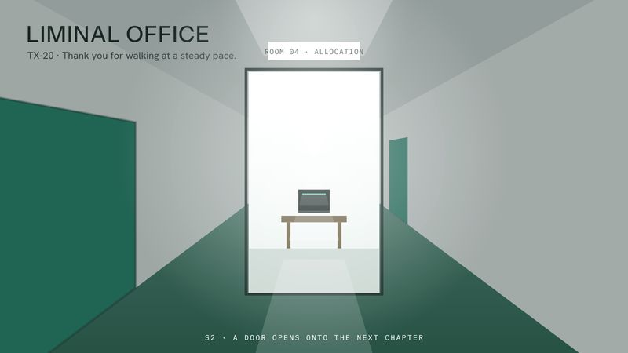

# TX-20 LIMINAL OFFICE

<!-- Generated from canon by scripts/build_derived.py. Do not edit by hand. -->

*White corridors, teal carpet, and numbers that feel uneasy.*



<div class="tx-swatches"><span class="tx-sw" style="background:#F4F6F5" title="--tx-bg #F4F6F5"></span><span class="tx-sw" style="background:#1D2B2A" title="--tx-ink #1D2B2A"></span><span class="tx-sw" style="background:#2E6F5E" title="--tx-a1 #2E6F5E"></span><span class="tx-sw" style="background:#1F8A78" title="--tx-a2 #1F8A78"></span><span class="tx-sw" style="background:#6B5E3C" title="--tx-a3 #6B5E3C"></span></div>

| Family | Home register | B2B fit | Data shapes | Best for |
| --- | --- | --- | --- | --- |
| E · Auteur and Title Design | B2B | Runs at Boardroom as is | score, comparison | Future of work, AI workforce, compliance |

## Tokens

Paste-ready custom properties. Download: [`tokens/themes/tx-20-liminal-office.css`](https://github.com/PolymathWizard/BHIL-Stagehand-Theme-Reel/blob/main/tokens/themes/tx-20-liminal-office.css).

```css
/* TX-20 LIMINAL OFFICE */
:root {
  --tx-id: "TX-20";
  --tx-bg: #F4F6F5;
  --tx-ink: #1D2B2A;
  --tx-a1: #2E6F5E;
  --tx-a2: #1F8A78;
  --tx-a3: #6B5E3C;
  --tx-glow: 0 0 14px color-mix(in srgb, var(--tx-a1) 55%, transparent);
  --tx-grain: .02;
  --tx-display: "Instrument Sans", system-ui, sans-serif;
  --tx-body: "Hanken Grotesk", system-ui, sans-serif;
  --tx-mono: "IBM Plex Mono", ui-monospace, monospace;
  --tx-display-weight: 500;
  --tx-body-weight: 400;
  --tx-mono-weight: 400;
  --tx-ease: linear;
  --tx-dur: 900ms;
  --tx-step: none;
}
```

## Essence words

work, identity, compliance, routine, unease, separation

## Look

Sterile white corridors, deep carpet green, pale teal, beige retro hardware, dark terminal panels with teal numerals. One-point corridors, sterile symmetry, low ceilings, isolated desks.

## Motion grammar

Deadpan. Clean cuts, long holds, precise slides at constant speed. Numbers drift in clusters. Fluorescent flicker stays at 3% opacity or less and 2 Hz or less.

## Web slot map

| Slot | Name | Fill |
| --- | --- | --- |
| S1 | Hero signature | an endless corridor in CSS 3D one-point perspective that scroll walks down; doors open onto chapters (T1). |
| S2 | Section transitions | clean slide-ins and held cuts. |
| S3 | Ambient layer | the fluorescent hum at the safety limits. |
| S4 | Data skin | a sorting interaction on a teal-on-black terminal grid: the reader drags numbers into bins, then sees the real distribution (predict-then-reveal). |
| S5 | Interaction and focus | corporate-polite toasts. |

## Data skin

Grids of numerals, bins, completion percentages, sterile tables.

## Video

Long hallway dollies, symmetrical framing, uneasy synth pads under a warm office-music bed.

## Boardroom translation

Native, and the strongest theme in the codex for AI-workforce briefs.

## Homage guardrails

No company name, logo, founder imagery or mascot from any series, and none of its vocabulary for departments, workers or procedures. These sit on top of the [Homage Rule](../codex/homage-rule.md).

## Collision note

Clear. Built for workforce, AI-plus-human staffing and compliance stories.

## Contrast

| Pair | Ratio | Use |
| --- | --- | --- |
| ink on ground | 13.5:1 | Body text |
| a1 on ground | 5.4:1 | Text and data lines |
| a2 on ground | 3.9:1 | Large text, icons and data lines |
| a3 on ground | 5.9:1 | Text and data lines |

## Type trio

| Role | Face | Weight | License |
| --- | --- | --- | --- |
| Display | Instrument Sans | 500 | OFL-1.1 |
| Body | Hanken Grotesk | 400 | OFL-1.1 |
| Mono | IBM Plex Mono | 400 | OFL-1.1 |

## In the reel

The live loop runs 22.5 s. Open it in the [reel](https://polymathwizard.github.io/BHIL-Stagehand-Theme-Reel/reel/stagehand-theme-reel.html#tx-20).

| Beat | Slot | Label | Seconds |
| --- | --- | --- | --- |
| 1 | S1 | Corridor walk | 6 |
| 2 | S2 | A door opens | 4 |
| 3 | S4 | Sort, then predicted vs actual | 9.5 |
| 4 | S5 | Polite toast | 3 |

## Prompt seed

```text
TX-20 LIMINAL OFFICE: the future of work as an endless white corridor; doors open onto chapters; the reader sorts the numbers before the real answer appears; constant speed, deadpan holds.
```
